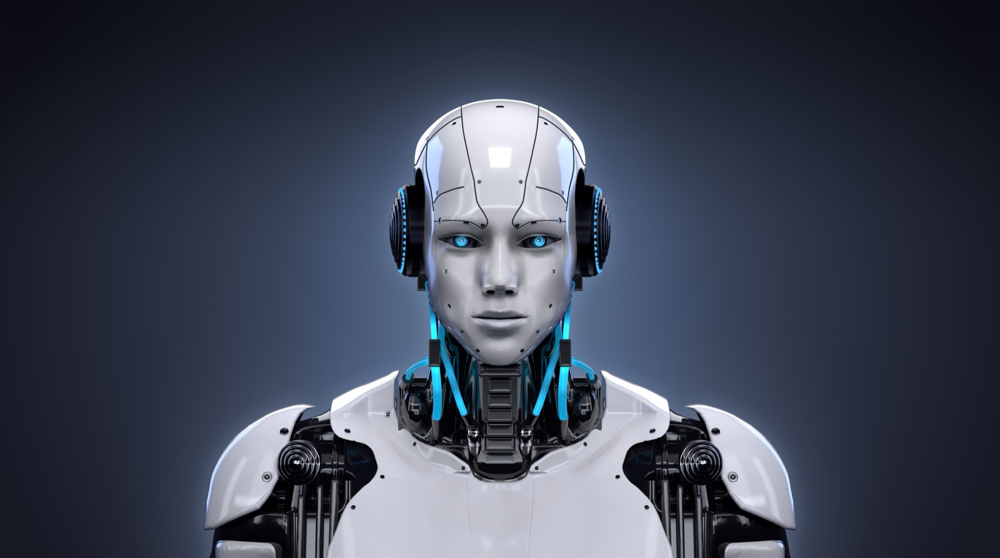

# Solrac Chess AI

**Downloads, features and news: [solrac-chess.com](https://solrac-chess.com)**

Solrac is an AI chess coach you talk to, hands free, on a photorealistic 3D board. It's
coming to the Mac first, then Windows and Linux.

## Issues and feedback

Found a problem, have a concern, or want to comment? Post it on the
[issues page](https://github.com/cjus/solrac-chess/issues).

## Open-source modules

Solrac itself is closed source. Its engine and voice are separate open-source programs that
it talks to through an open protocol:

- [cjus/chessengine](https://github.com/cjus/chessengine): the chess engine and its rules
  library. `MIT OR Apache-2.0`.
- [cjus/chess-node-protocol](https://github.com/cjus/chess-node-protocol): the protocol
  Solrac and its modules speak. Specification CC-BY-4.0, code `MIT OR Apache-2.0`.
- [cjus/solrac-voice](https://github.com/cjus/solrac-voice): speech and transcription on
  your computer. Our code `MIT OR Apache-2.0`; the program as a whole GPL-3.0, because it
  links eSpeak NG.

These repositories aren't public yet.

The voice downloads [sherpa-onnx](https://github.com/k2-fsa/sherpa-onnx)'s releases of
[Kokoro-82M](https://huggingface.co/hexgrad/Kokoro-82M) (Apache-2.0), with
[eSpeak NG](https://github.com/espeak-ng/espeak-ng)'s pronunciation data (GPL-3.0-or-later),
and NVIDIA's [Parakeet TDT 0.6B v2](https://huggingface.co/nvidia/parakeet-tdt-0.6b-v2)
([CC-BY-4.0](https://creativecommons.org/licenses/by/4.0/)), unchanged.

## Licence

Solrac is © 2026 Carlos Justiniano. All rights reserved. The open-source modules and the
models are under their own licences, given above.
