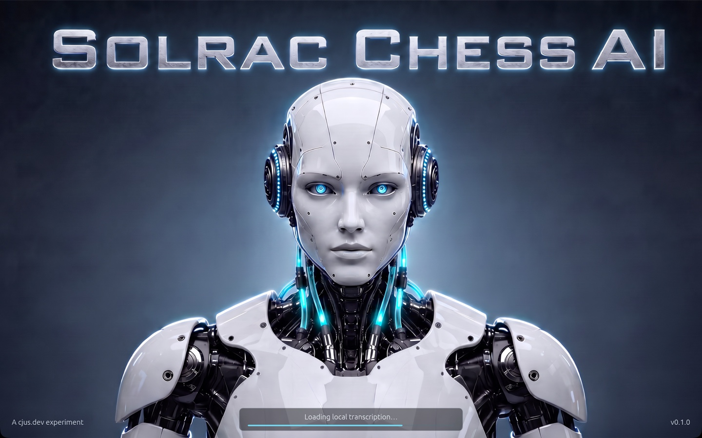

# Solrac Chess

Solrac is a chess program for the Mac. You play on a photorealistic 3D board, against
[cb2026](#open-source-modules), an open-source chess engine, and you can talk about the game
with an AI that sees the board, by typing or by voice.

Solrac is experimental and in active development.

## Download

There is no release yet. Each release will be listed here, with a link to download it from
the PNX Studios CDN (`https://cdn.pnxstudios.com/solrac/releases/`) and the file's SHA-256 so
you can check what you downloaded.

| Version | Date | System | Download | SHA-256 |
| --- | --- | --- | --- | --- |
| — | — | macOS on Apple silicon | Not released yet | — |

Windows and Linux builds are planned.

## What it does

- **A board worth sitting at.** A wooden tournament set on a lacquered board, in sunlight,
  which you can turn and zoom. Move by clicking or dragging.
- **Play cb2026**, play another person at the same board, or watch cb2026 play itself, with
  a chess clock beside the board.
- **Talk about the game.** The chat can explain the position, turn the camera, play your moves
  and start a new game. It never changes the game on its own: every move it proposes is
  checked against the rules before Solrac plays it. The chat uses an AI model through
  [OpenRouter](https://openrouter.ai), with your own OpenRouter key.
- **Speak to it and hear it.** Hold Talk and say your move or your question. Speech and
  transcription run on your Mac, so your recordings stay on it.

The first time the voice is used, Solrac's voice module downloads its speech and
transcription models (about 830 MB) from the PNX Studios CDN. Until they are ready,
OpenRouter's models read and hear for it.

## Open-source modules

Solrac itself is closed source. It plays and speaks through open-source programs, which it
talks to through an open protocol, so anyone can use them in their own projects, or point
Solrac at their own engine.

| Module | What it is | Licence | Source |
| --- | --- | --- | --- |
| **cb2026** | The chess engine and its rules library (`cb2026-chess`): legal moves, SAN, FEN and PGN. Solrac starts it as a separate program, and it can also run on another machine | `MIT OR Apache-2.0` | [cjus/chessengine](https://github.com/cjus/chessengine) (not public yet) |
| **Chess Node Protocol (CNP)** | The protocol Solrac and its modules speak: JSON-RPC 2.0 over stdin/stdout, or WebSocket over TLS on a network. Its specification, the `cnp` Rust crate and conformance tests | Specification CC-BY-4.0, code `MIT OR Apache-2.0` | [cjus/chess-node-protocol](https://github.com/cjus/chess-node-protocol) (not public yet) |
| **solrac-voice** | Speech and transcription on your computer, through [sherpa-onnx](https://github.com/k2-fsa/sherpa-onnx) | Our code `MIT OR Apache-2.0`; the program as a whole GPL-3.0, because it links eSpeak NG | [cjus/solrac-voice](https://github.com/cjus/solrac-voice) (not public yet) |

Solrac's own build holds no GPL code: the modules are separate programs, which Solrac starts
and talks to. Each release will name the exact commit of each module it ships, and include
each module's licence and the notices of the open-source libraries Solrac is built with
(`THIRD-PARTY-NOTICES.txt`).

## Models and third-party notices

The voice's models are sherpa-onnx's releases, unchanged, which `solrac-voice` downloads.
They keep their own licences:

| Model | What it does | Licence |
| --- | --- | --- |
| [Kokoro-82M](https://huggingface.co/hexgrad/Kokoro-82M) v1.0, packaged by sherpa-onnx | Reads the chat's replies aloud | Apache-2.0 |
| [eSpeak NG](https://github.com/espeak-ng/espeak-ng)'s pronunciation data, in Kokoro's archive | Turns text into phonemes for Kokoro | GPL-3.0-or-later |
| [Parakeet TDT 0.6B v2](https://huggingface.co/nvidia/parakeet-tdt-0.6b-v2) by NVIDIA, packaged by sherpa-onnx | Hears what you say | [CC-BY-4.0](https://creativecommons.org/licenses/by/4.0/) |

## Licence

Solrac is © 2026 Carlos Justiniano. All rights reserved. The open-source modules and the models
are under their own licences, given above.
