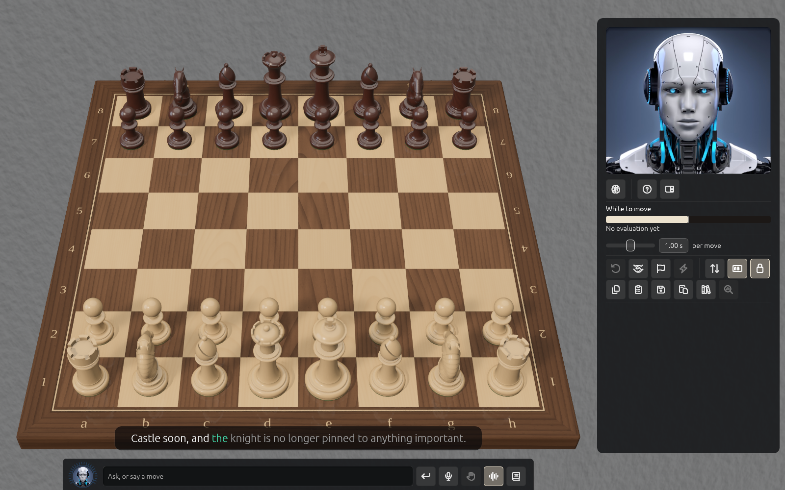

# The chat and voice

Talk or type to Solrac along the bottom of the board. It can look at the position, play moves
you ask for, change settings and explain what it finds.

## The Rail

The strip under the board is the **Rail**. From left to right:

- **The dial**: Solrac's face with a ring of ticks. While you speak, the lit ticks show how loud
  the microphone hears you. While Solrac speaks, all of them are lit, and while it thinks, a lit
  run chases round.
- **The field**, "Ask, or say a move": type up to 500 characters and press **Enter**. The field
  takes the whole width between the dial and the buttons. If the chat can't run, the field says
  why, as "The chat is off: ...".
- **Send**, which turns into **Stop** while Solrac is working out a reply or speaking. Stop ends
  the reply, the speech and any line it is showing on the board.
- **Talk**, **Hands-free** and **Read aloud**, when the voice is ready (see below).
- **History**, which opens the **Chat history** window.

**Tab** hides the panel and the Rail together, and shows them again. What you were typing is
kept.

## What it does

- It **plays a move only when you ask**, and the board checks every move it plays. It asks
  **Yes** or **No** before starting a new game, resigning, loading a game over one in
  progress, or agreeing to a draw, and when you accept one Solrac offers. Answer in the chat
  or press the buttons.
- It can analyse the position (one to five lines, quick or deep), compare moves, review a
  move, find a threat, or explain an evaluation term by term. The same position gets the same
  analysis every time.
- It can turn, tilt, zoom and fit the camera or face a side, and change the clock, strength,
  think time, lights, environment, sound and voice, labels, the camera lock and the panel.
- It can take back, offer or answer a draw, copy the position or the game, save or load a game
  from text, step through a game, and play on from a position.
- When it describes a line, it **plays it out on the board** with arrows and rings, timed to
  its voice, then restores your game. A banner with **Stop** shows while it does. Press Esc,
  click **Stop**, click the board, hold Talk, type a message, or change the game, and it stops.
- During a game it gives ideas, not moves, and nothing on your turn from the engine.

## Chat history

**History** opens a window you can move and resize. Your words are on the right and Solrac's
on the left, with small italic lines for what it did (a move played, a setting changed).
Errors are in a warning colour. In Hands-free, speech that wasn't meant for Solrac, such as you
talking to someone in the room, is shown dimmed as "Not meant for the chat, so it wasn't
answered."

## What it costs and what is sent

The chat is answered by a language model reached through PNXStudios' service, paid with your
**tokens**, so there is no key to set up. It works with a licence seat on this machine or with a
signed-in account. If you run out, the chat tells you so. What is sent to get a reply is what
you type or say (as text) and the position and analysis the question needs. Your games library
and settings stay on your Mac.

## Voice

- **Talk**: hold Space or the Talk button, for up to 30 seconds. The notice above the Rail
  counts the seconds ("Listening: let go to send"). What you say is turned into text **on your
  Mac** and never saved; online transcription is only a fallback while the voice downloads.
- **Hands-free** keeps the microphone open without a wake word. It waits for you to pause,
  ignores Solrac's own speech, lets you speak over it, and hears an unclear move twice and
  checks it against the legal moves. Half a move, such as "Bishop", waits a moment for the
  rest. It is off at each start. The button is greyed until the voice is ready, with the
  reason on hover ("Preparing the voice...", or "Unavailable: ..." and why).
- **Read aloud** switches replies on (Always) or off (Never). **Preferences → Avatar → Voice**
  chooses Automatic, Always, In voice mode (when Hands-free is on) or Never, and the voice.
  Automatic reads everything, except on a computer with a weak graphics card, where it reads
  only in voice mode ([On a slower computer](slow-computers.md)).
- The voice models (more than 800 MB) download once.

## Detail and pace

Under **Preferences → Avatar → Explanation**, **Detail** chooses how much Solrac says and how
many moves it plays on the board: **Short** is the point in a sentence with one short line of a
few moves, **Normal** (the default) a few sentences with a line or two, and **Verbose**
everything, with up to four lines of a dozen moves. The change applies from your next message.

**Pace** (Standard, Relaxed or Slow; Relaxed is the default) sets how long Solrac pauses
between sentences and after each move it plays on the board, so you can take in what was said
and what moved before the next point. It changes the pauses, not the voice's speed.

## Captions

What Solrac says appears as **captions** above the Rail, like subtitles in a film: a sentence
at a time, with each word lighting up as it is spoken, so the text matches what you hear. The
words already said are white, the word being said is teal and the rest are dimmed. A long
sentence is split at a comma so a caption is never a wall of text. The last caption stays for
five seconds.

The computer's moves are captioned and read aloud too ("Black plays knight f6.") while **Read
aloud** is on, whether you type or talk. When two engines play each other they are only
announced if you talk to Solrac.

Captions show even when **Read aloud** is off, or you can't hear, and for replies you typed: the
sentences come at reading speed instead. When Solrac describes a line, the moves and arrows on
the board arrive as the words that name them are spoken. While it thinks, a short note takes the
caption's place, and so does an error.

To turn captions off, clear **Show captions** in **Preferences → Avatar**. Those notes and
errors still appear; **History** still has everything Solrac said.
