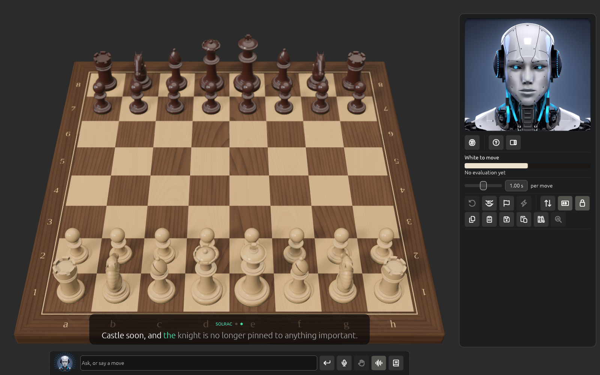

# The chat and voice

Talk or type to Solrac in the strip along the bottom of the board. It can look at the position, play moves
you ask for, change settings and explain what cb2026 finds.

## What it does

- It **plays a move only when you ask**, and the board checks every move it plays. It asks
  Yes or No before starting a new game, resigning, or loading a game over one in progress.
- It can ask cb2026 to analyse the position, compare moves, review a move, find a threat or
  explain an evaluation. The same position gets the same analysis every time.
- It can turn the camera, change the clock, strength, lights, sound and voice, take back,
  offer a draw, save or load a game, and step through one.
- When it describes a line, it **plays it out on the board** with arrows and rings, then
  restores your game. Esc stops it.

## What it costs and what is sent

The chat is answered by a language model reached through PNXStudios' service, paid with your
**tokens**, so there is no key to set up. It works with a licence seat on this Mac or with a
signed-in account. What is sent to get a reply is what you type or say (as text) and the
position and analysis the question needs. Your games library and settings stay on your Mac.

## Voice

- **Talk**: hold Space or the Talk button, for up to 30 seconds. What you say is turned into
  text **on your Mac** and never saved; online transcription is only a fallback.
- **Hands-free** keeps the microphone open without a wake word. It waits for you to pause,
  ignores Solrac's own speech, lets you speak over it, and hears an unclear move twice and
  checks it against the legal moves. It is off at each start.
- **Read aloud**: replies are spoken on your Mac. **Preferences → Avatar → Voice** chooses
  Always, In voice mode (when Hands-free is on) or Never, and the voice.
- The voice models (about 830 MB) download once.

## Captions

What Solrac says appears as **captions** above the strip, like subtitles in a film: a sentence
at a time, with each word lighting up as it is spoken, so the text matches what you hear. The
words already said are white, the word being said is teal and the rest are dimmed. A long
sentence is split at a comma so a caption is never a wall of text.

Captions show even when **Read aloud** is off, or you can't hear: the sentences come at
reading speed instead. When Solrac describes a line, the moves and arrows on the board arrive
as the words that name them are spoken. While it thinks, a short note takes the caption's
place, and so does an error.

The strip itself is for you: the field takes the whole width between Solrac's avatar and the
buttons. The book button opens the whole conversation.
