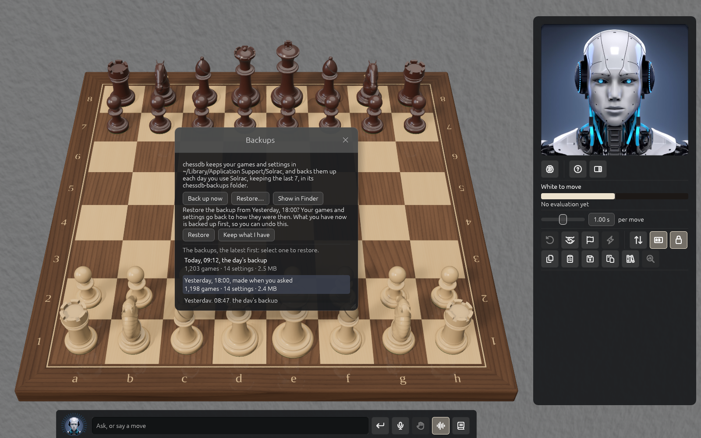

# Your games, imports and backups

Every game you play in Solrac is saved as you play it: after each move, each takeback and each
new game, and when you quit. Every game you load or import is kept too. They are kept on your
computer, by Solrac's database, and **nothing is sent anywhere**.

If the Games window says "Your games are kept by chessdb, which isn't running", the database that
keeps your games isn't running, so no games are listed and nothing can be imported or backed up.
The window gives the reason after that sentence.

## The panel's file buttons {#files}

The panel has a row of file buttons, in this order:

1. **Copy the position (FEN)** puts the position on the clipboard.
2. **Copy the game (PGN)** puts the whole game on the clipboard.
3. **Save the game (PGN)** writes it to the **Solrac** folder in your Documents folder, in a file
   named for the date, the time and the players, such as
   `2026-10-22 15.04 Player vs cb2026 0.1.0.pgn` (the engine's name and version). There is no
   dialog. A second game saved in the same minute with the same players gets "(2)" after its
   name. A line under the row says where it went ("Saved as ~/Documents/Solrac/...") or why it
   couldn't be saved.
4. **Paste** loads what is on the clipboard: a game (PGN) or a position (FEN) to step through, or,
   if it holds several games, imports them (see below).
5. **Games** opens the Games window, and closes it again when it is lit. You can also use
   **File → Games Library** or **⌘L** (**Ctrl+L**).
6. **Analyse** reviews a game once it is over.

**File → Copy FEN** and **File → Copy PGN** do the same as the first two buttons. Tags,
comments, symbols and variations are kept as they were read.

## The Games window {#games}

The games are listed newest first. Each row shows who played, its result (or that it is
unfinished), how many moves it had and when it was last played; a game you loaded or imported says
"added" and the date instead. The game on the board is marked **On the board**. A long list fills
in as you scroll. If you have no games, the window says so.

Click a game to select it, then use the buttons along the top:

1. **Replay** loads it to step through from the start. A double click on the row does the same.
2. **Carry on** plays on from where an unfinished game was left, with who plays each side and the
   clock's times.
3. **Save PGN** writes it to the Solrac folder in your Documents folder, as above.
4. **Copy PGN** puts it on the clipboard.
5. **Delete** removes it after asking again: **Delete** or **Keep**. It can't be undone.
6. **Import** brings in the games of a PGN file.
7. **Backups** opens the Backups window, described below.

Hover a button that is greyed out to see why.

- **Carry on** is greyed for the game on the board, for a game that is over, and for a game that
  was loaded or imported, since such a game doesn't say who played it. **Replay** it instead, then
  choose how to play from there.
- **Delete** is greyed for the game on the board, and for the game Solrac will carry on with the
  next time it starts.

Type in the box at the top to **search**: only games whose players' names or tags (event, site,
date) have every word you typed are listed, ignoring case. It searches every game, not only the
ones on screen. **Clear** empties the box.

The window moves by its title and resizes from its edges. It opens in the middle of the board each
time; if you move it, it stays where you put it until you close it. It closes with its **X**.

## Putting games in {#importing}

The same rule decides what happens to the text or file you give Solrac:

- **A single game, or a position**, is loaded to step through. It is also kept in your games,
  once: pasting or dropping the same game twice keeps it once. A line in the panel says what
  happened, such as "Loaded Morphy vs Duke, Paris 1858: 17 moves to step through", or "Not
  loaded" and why.
- **A text or file with more than one game, or a file larger than 1 MB**, is imported into your
  library. The Games window opens by itself and says how far the import has got, with **Stop**.

How to give it:

- **Drop** a `.pgn` or `.fen` file on the window.
- **Paste** with the panel's paste button.
- **Import**, in the Games window, opens a file dialog for a PGN file, up to 256 MB. It always
  imports, however many games the file holds.

A file of thousands of games goes in within seconds. When it is done the window says what it did,
for example "Imported games.pgn: 11,000 added, 3 in your games already, 12 couldn't be read". It
lists only what applies:

- **added**: new in your library;
- **in your games already**: kept before; importing the same file twice adds nothing;
- **in the file twice**: the file held the same game more than once;
- **couldn't be read**: not a game Solrac could read;
- **too long to keep**: a game of more than 1,000 moves.

If you press **Stop**, the games already added stay, and the window says "Stopped importing" and
how many were added. Only one import runs at a time; another says "Not imported: an import is
under way". Older PGN files that aren't UTF-8 are read too. Comments, symbols and variations in a
game are kept as they were read, so a game you open to analyse keeps its notes.

If the database isn't running (see above), only a single game can be loaded: a file larger than
1 MB says "Not loaded", and a file of several games loads its first game.

## Carrying on after you quit {#resume}

If you quit in the middle of a game, Solrac carries on with it at the next start, as it was. The
clock starts again after your next move, so nobody loses time while Solrac starts. A game that was
over doesn't come back, but a new game of the same kind starts, with the time you set for new
games.

If you start moving, or load a game, before Solrac has found the old game, the old game isn't
taken up; it waits in your Games window and you can **Carry on** with it from there. While you
step through a loaded game, the game you were playing stays the one Solrac carries on with, and
closing the loaded game takes you back to it.

## Backups {#backups}

Solrac backs up your settings and your games once a day, a few seconds after it starts on a day
you use it, and keeps the last seven. The **Backups** window lists them, newest first, each with
when it was made ("the day's backup", "made when you asked" or "before a restore"), how many games
and settings it holds, and how large it is. A window with no backups yet says the first is made a
few seconds after Solrac starts.

- **Back up now** makes one at once.
- **Show in Finder** opens the folder the backups are kept in. On Windows the button says **Show
  in Explorer**, and on Linux **Show folder**.
- **Restore...** puts the selected backup's games and settings back. It asks again, with
  **Restore** or **Keep what I have**. Before it restores, Solrac backs up what you have ("before
  a restore"), so a restore can itself be undone by restoring that one. The game on the board
  stays on the board.

**Restore...** is greyed, with its reason when you hover it, when no backup is selected, while
your settings are still being saved ("Wait for your settings to be saved") and while an import
runs ("Wait for the import to end").

## Your settings

Window size, clock, strengths, lights, sound, notation, avatar, board look, text size and voice
choices are remembered between runs.
