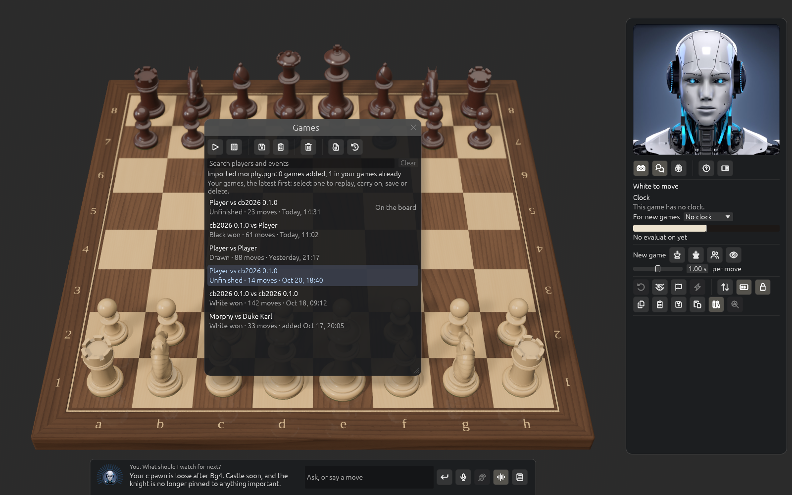

# Your games, imports and backups

## The library

Every game is saved after each move. **File → Games Library** (⌘L) lists them, newest first,
with search. For each you can Replay, Carry on, Save PGN, Copy PGN or Delete.

## Loading and saving

- **Load** a game or position by pasting PGN or FEN, dropping a `.pgn` file on the window, or
  from the command line with `--open`.
- **Copy FEN**, **Copy PGN** and **Save PGN** (to `Documents/Solrac`). Tags, comments, symbols
  and variations are kept as read.

## Import

Import a file with many games; it runs in the background with progress, a Stop button and a
summary of games added, already present and repeated.

## Backups

Solrac backs up your library daily and keeps seven. **Back up now**, **Restore** and **Show in
Finder** are in the Games Library's backups section.

## Your settings

Window size, clock, strengths, lights, sound, notation, avatar, board look, text size and voice
choices are remembered between runs.
