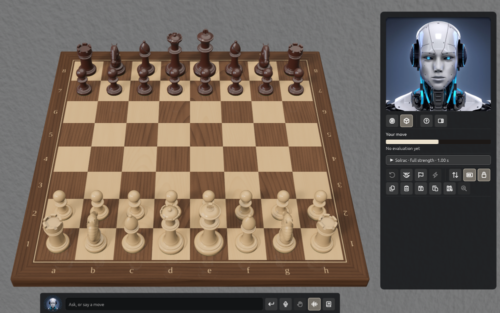
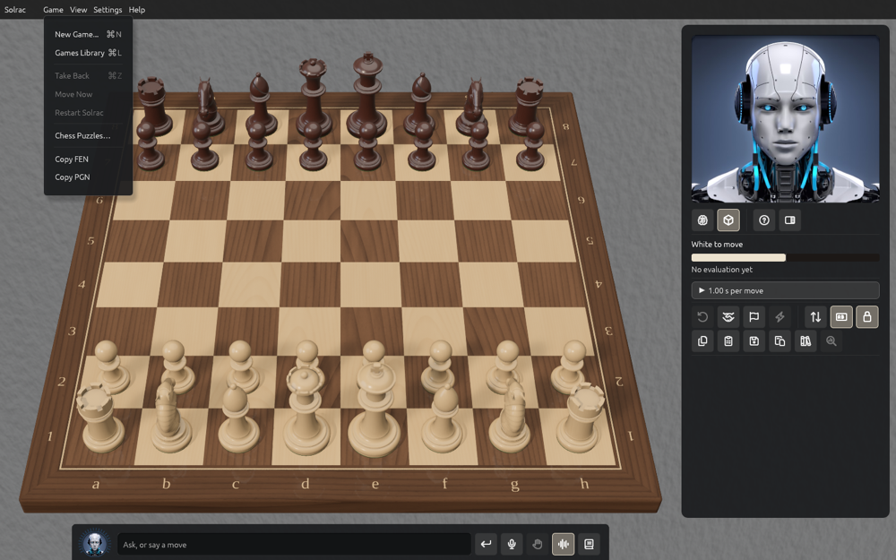

# Getting started

Solrac is a chess board you can talk to. You play against **Solrac**, the engine inside it
(cb2026), you can ask it why it played a move, and you can save and review every game. This
chapter takes you from the first start to your first saved game.

## Your licence

After you buy Solrac, an email brings a **licence key**. The first time you start Solrac it
shows **Activate Solrac**: type the key in (or choose **Paste**), give this machine a name if
you like, and choose **Activate**. **Lost your key?** is on the same screen.

- One key works on **three machines**. If three already use it, Solrac lists them, with when
  each was last seen, and lets you **Deactivate** one to free its place, or **Use another
  key**. Another machine can be freed twice in 30 days.
- To free this machine yourself, choose **Deactivate this machine** in
  **Settings → Licence**; Solrac asks for the key again before you play here.
- Activation gives Solrac a signed certificate that it checks on your machine, without the
  internet, each time it starts. It renews itself about weekly and stays valid for 30 days if
  the licence service can't be reached, so a short time offline never stops you playing. If
  it can't confirm the licence at all, it says so and offers **Try again**.
- On Linux, see [Solrac on Linux](linux.md) for downloading and starting Solrac.
- The key is kept in the system's secure storage: the macOS Keychain on a Mac, and a file only
  you can read in Solrac's data folder on Linux.

## The window

- **The board** fills the middle. Click a piece and then a square, or drag it.
- **The menu bar** is along the top of the window (the next picture shows it): **Solrac** (About, Settings, Quit), **Game** (New Game,
  Games Library, Take Back, Chess Puzzles, Copy FEN, Copy PGN and more), **View**, **Settings** and **Help**.

- **The panel** is on the right: Solrac's face, a row of buttons under it (Engine Thinking, the
  2D / 3D board, Help, hide the panel), whose move it is and how the position
  looks (the bar), one line saying how strongly Solrac plays and how long it thinks per move
  (click it for the sliders), two rows of icon buttons (take back, draw,
  resign, move now, flip, labels, lock the camera; then copy, paste and save a game, the games
  library and analyse) and the list of moves. In a game with a clock, the clocks are here too. Hover a button to see its name.
- **The chat** is the strip along the bottom of the board. Type in it, or press the
  microphone, to ask Solrac a question or to tell it a move. See [The chat and voice](chat-and-voice.md).

**Tab** hides the whole interface, the menu bar and the chat too, and brings it back.

Solrac spells the way your Mac's language does: the British way when it is set to English
(UK), Irish, Australian or another English spelt like them, and the American way otherwise.

## Your first game

1. Choose **Game → New Game** (⌘N, Ctrl+N elsewhere).
2. Under **Play**, pick **White**, **Black**, **Two players** (one board, two people) or
   **Watch** (Solrac plays itself).
3. Pick a **Time control**, or **None** for no clock.
4. Set **Solrac's strength** with its slider.
5. Choose **Start**, or press Enter.

You can change Solrac's strength during the game too, with the strength slider in the panel (click the line under the evaluation to open it). The game in progress is
saved as you play, so quitting and starting again carries on where you were; a finished game
does not come back, and Solrac starts a new game of the same kind instead.

Solrac runs once at a time: starting it again while it is open brings the open window to the
front.

Next: [Playing a game](playing.md).

## Your account

Signing in to your solrac-chess.com account is separate from the licence: an account doesn't
prove a purchase. Open **Settings → Account** and sign in; your browser opens for the
sign-in and returns to Solrac. **Sign Out** is on the same page. The chat can use your account
to pay for its replies (see [The chat and voice](chat-and-voice.md)).

## Updates

When a newer Solrac exists, a card appears over the panel with **Download** and **Not now**,
once for each new version, and **Settings → Licence** keeps the line "Solrac … is
available". It can take up to a week to show, since it arrives with the licence's weekly
renewal. Download opens the download page; Solrac never replaces itself.

## Solrac for iPad {#ipad}

Solrac for iPad is for playing and learning with Solrac. Everything you do while playing a game is
there: all four kinds of game and every time control, the coaching chat with Talk and
Hands-free, the starter set of chess puzzles, Review, and every chess set, environment and room
paint. Some of the deep study tools are only in Solrac for Mac, the full study workstation:

- **Engine Mind** and the **Opening Explorer**'s games (the opening's name shows at the top of
  the inspector's Moves tab).
- **Puzzle packs** beyond the starter set.
- **Editing a game in Analyse**: comments, symbols and variations. On an iPad, **Replay** steps
  through a finished game and shows a review's marks and better lines.
- **Importing PGN files.** Copying and sharing a game's PGN or FEN works on both.
- **Playing on another computer**, and the Backups window.

To see what Solrac for Mac adds, visit solrac-chess.com.

### The iPad layout on a computer {#ipad-layout}

If you know Solrac for iPad, you can keep its design on a Mac, Windows or Linux computer:
choose **iPad** under **Layout** on Settings' **Display** page, and Solrac uses it the next time
it starts. Nothing is taken away: the iPad layout has every feature of your computer's Solrac,
and your keyboard shortcuts all work. It only moves the menu bar's commands:

- **Actions**, at the top of the menus on the left, has the Game menu's commands and the View
  menu's: Lock Camera, Reset Camera and Zoom to Fit, Show Labels, Show Panel, Larger Text and
  Smaller Text, and the Environment list.
- The menus have the Opening Explorer, **Documentation** (cb2026's book, in your browser) under
  Solrac Help, and **Quit Solrac** at the bottom.
- Engine Thinking and Engine Mind are on the inspector's **Engine** tab, and the Settings menu's
  toggles are on Settings' pages.

It is the iPad's design only: a computer has no on-screen keyboard, and you use the mouse and
keyboard as before. To go back, choose **Computer** under **Layout**.

## The voice on an iPad

On an iPad, the first time you start Solrac it asks whether to download its voice (about
830 MB, once), which reads replies aloud and hears what you say. It needs about 2 GB of free
space while it unpacks. Choose **Download** and it shows on the loading screen with the usual
**Continue** button. Choose **Not now** to type instead: Solrac doesn't ask again, and
**Settings → Voice and Chat** has **Download** when you want it. See
[The chat and voice](chat-and-voice.md).

## Chess puzzles

The first time you start Solrac it asks whether to set up chess puzzles, a one-time download of
4 MB. See [Chess puzzles](puzzles.md) for what they are, how they are set up and how to solve
them.

## Where to look things up

- **Help → Solrac Help** (F1, or ⌘? on a Mac) opens the same help inside Solrac. A **?** on a page of Settings
  opens its part of the help. The icon at the top right of its panel opens it in a window of its own, for a
  second monitor: a **?** in Settings and a link in a page show their page there.
- [Keyboard shortcuts](shortcuts.md) lists every key.
- **Solrac → About Solrac** says which version you have; say so when you write to us. On an
  iPad, **About Solrac** is the last of the menus on the left, and the version is at their
  bottom.
- **Help → Feedback…** sends a note to PNXStudios. You need to be signed in.
- **Help → Solrac Documentation** opens the engine's book (cb2026), not this guide.
