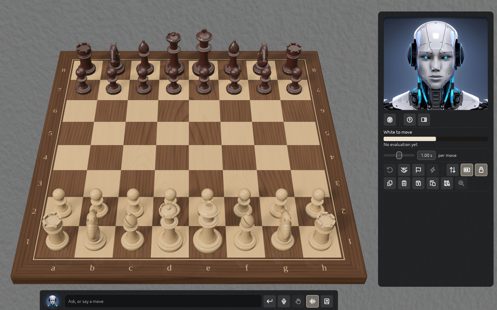

# Getting started

Solrac is a chess board you can talk to. You play against **Solrac**, the engine inside it
(cb2026), you can ask it why it played a move, and you can save and review every game. This
chapter takes you from the first start to your first saved game.

## Your licence

After you buy Solrac, an email brings a **licence key**. The first time you start Solrac it
shows **Activate Solrac**: type the key in (or choose **Paste**), give this machine a name if
you like, and choose **Activate**. **Lost your key?** is on the same screen.

- One key works on **three machines**. If three already use it, Solrac lists them, with when
  each was last seen, and lets you **Deactivate** one to free its place, or **Use another
  key**. Another machine can be freed twice in 30 days.
- To free this machine yourself, choose **Deactivate this machine** in
  **Preferences → Licence**; Solrac asks for the key again before you play here.
- Activation gives Solrac a signed certificate that it checks on your machine, without the
  internet, each time it starts. It renews itself about weekly and stays valid for 30 days if
  the licence service can't be reached, so a short time offline never stops you playing. If
  it can't confirm the licence at all, it says so and offers **Try again**.
- On Linux, see [Solrac on Linux](linux.md) for downloading and starting Solrac.
- The key is kept in the system's secure storage: the macOS Keychain on a Mac, and a file only
  you can read in Solrac's data folder on Linux.

## The window

- **The board** fills the middle. Click a piece and then a square, or drag it.
- **The menu bar** is along the top of the window (the picture leaves it out): **Solrac** (About, Preferences, Quit), **File** (New Game,
  Copy FEN, Copy PGN, Games Library), **Game**, **View**, **Settings** and **Help**.
- **The panel** is on the right: Solrac's face, whose move it is and how the position
  looks (the bar), how long Solrac thinks per move, two rows of icon buttons (take back, draw,
  resign, move now, flip, labels, lock the camera; then copy, paste and save a game, the games
  library and analyse) and the list of moves. In a game with a clock, the clocks and the
  strength sliders are here too. Hover a button to see its name.
- **The chat** is the strip along the bottom of the board. Type in it, or press the
  microphone, to ask Solrac a question or to tell it a move. See [The chat and voice](chat-and-voice.md).

**Tab** hides the whole interface, the menu bar and the chat too, and brings it back.

## Your first game

1. Choose **File → New Game** (⌘N, Ctrl+N elsewhere).
2. Under **Play**, pick **White**, **Black**, **Two players** (one board, two people) or
   **Watch** (Solrac plays itself).
3. Pick a **Time control**, or choose no clock: select the **Clock stands on** side again to
   turn the clock off.
4. Choose **Start Game**, or press Enter.

Set how strong Solrac plays with the strength slider in the panel. The game in progress is
saved as you play, so quitting and starting again carries on where you were; a finished game
does not come back, and Solrac starts a new game of the same kind instead.

Next: [Playing a game](playing.md).

## Your account

Signing in to your solrac-chess.com account is separate from the licence: an account doesn't
prove a purchase. Open **Preferences → Account** and sign in; your browser opens for the
sign-in and returns to Solrac. **Sign Out** is on the same tab. The chat can use your account
to pay for its replies (see [The chat and voice](chat-and-voice.md)).

## Updates

When a newer Solrac exists, a card appears over the panel with **Download** and **Not now**,
once for each new version, and **Preferences → Licence** keeps the line "Solrac … is
available". It can take up to a week to show, since it arrives with the licence's weekly
renewal. Download opens the download page; Solrac never replaces itself.

## Where to look things up

- **Help → Solrac Help** (F1, or ⌘? on a Mac) opens the same help inside Solrac. A **?** beside a Preferences
  tab opens that tab's page.
- [Keyboard shortcuts](shortcuts.md) lists every key.
- **Solrac → About Solrac** says which version you have; say so when you write to us.
- **Help → Feedback…** sends a note to PNXStudios. You need to be signed in.
- **Help → Solrac Documentation** opens the engine's book (cb2026), not this guide.
