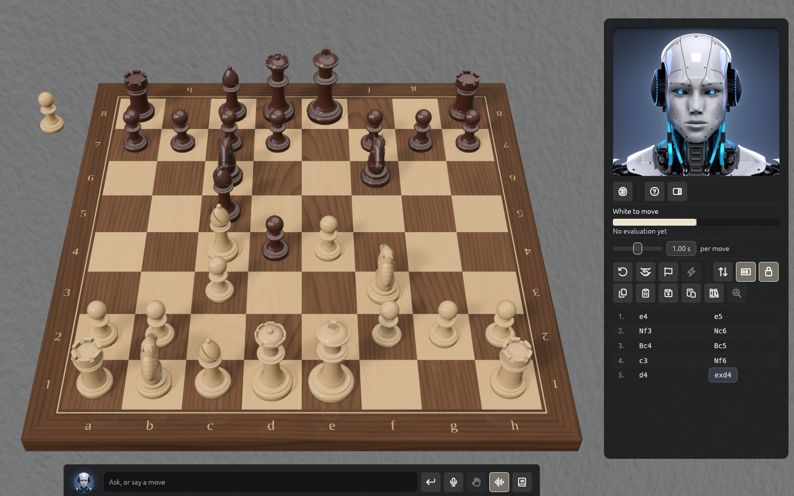

# Welcome

*Pictures are made by Solrac's own renderer; the engine figures, games and chat lines in them are samples.*

Solrac is an AI chess coach you talk to, on a photorealistic 3D board. You play against
Solrac, the chess engine inside it (cb2026), and learn from it: it can review your games, show how it weighs a
position, and answer questions through the chat, by typing or by voice.

This guide is for people who have Solrac. It is written so that you can follow it without
being technical; where an engineer would want more, the detail comes after the plain steps.

The first chapter is the newest feature, [playing on an engine on another
computer](network-play.md): a laptop can use the engine of a faster machine in the next room.
The other chapters are on their way, and are listed, unlinked, in the contents.

Found a mistake in the guide, or something that doesn't work as it says? Please post it on
the [issues page](https://github.com/cjus/solrac-chess/issues).
