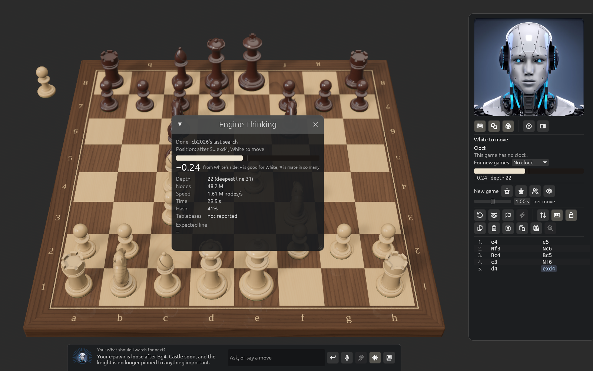

# Learning from the engine

## Review

The panel's **Review** button has cb2026 search every position of your game's main line. It
marks inaccuracies (`?!`), mistakes (`?`) and blunders (`??`), adds a better line after
mistakes and blunders, and writes each move's evaluation into the game, along with which
engine and depth it used. A progress bar shows how far it is, and you can cancel. Nothing is
written unless the review finishes. The same position always gets the same review.

Under the move list, an **evaluation graph** shows a bar for each move, with marked moves as
dots; click one to see the move.

## Analyse

Switch on **Analyse** to step to any position and play a move to follow or add a variation.
Right-click a move to edit its comment and symbols, promote or delete a variation, or delete
the moves from there. Edits are saved in your library as a new version.

## Replay

Load a game and use Start, Back, Forward and End, or the arrow keys. **Play from here** carries
on from any position, including a variation, as any kind of game.

## Engine Thinking

Press ⌘E for the evaluation bar, depth, nodes, speed, hash use and the line the engine
expects. While you play against it, it gives no hints on your turn.

## Engine Mind

Press ⌘↑ to enter a full-window 3D view of the engine's best lines, drawn as a tree of small
boards with the main line in front. Pan and zoom to explore; panels explain each move the
engine weighed. Leave with ⌘↓ or Esc.
