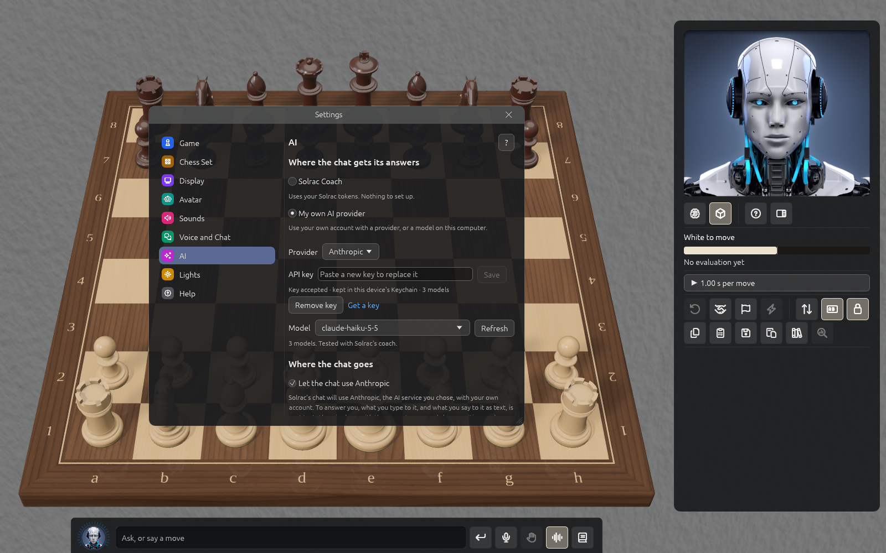

# Using your own AI

By default the chat is answered by the **Solrac Chess AI Coach**, paid with your Solrac tokens,
with nothing to set up. Under **Settings → AI** you can use your own account with an AI company
instead, or a model running on your own computer. The chat then works as it always does (the
same analysis, tools, captions and voice), but what you type goes straight from Solrac to the
provider you chose. **Nothing goes through PNX Studios, and no Solrac tokens are spent.** Your
provider bills your account.

## Choosing

Under **Settings → AI**, pick **Solrac Coach** or **My own AI provider**, then a provider from
the list:

| Provider | What you need | Where |
| --- | --- | --- |
| **Anthropic** | an API key, and credit on the account | Anthropic Console |
| **OpenAI** | an API key, and credit on the account | OpenAI Platform |
| **Google Gemini** | an API key from Google AI Studio | Google AI Studio |
| **OpenRouter** | an API key, and credit on the account | OpenRouter |
| **Ollama** | Ollama running on this computer (not on an iPad) | ollama.com |
| **LM Studio** | LM Studio's local server running (not on an iPad) | lmstudio.ai |
| **OpenAI-compatible server** | the server's address and a key (a server that wants none accepts any text) | your own |

Anthropic, OpenAI, Gemini and OpenRouter have been tried with Solrac's coach. A model running on
your own computer works only if it can call tools (many small ones can't): it may play poorly
or ignore the board. If it doesn't suit you, switch back to Solrac Coach in a click.

## Getting and saving a key

1. Press **Get a key** on the AI page. It opens the provider's own page for keys, in your
   browser. Sign in or create an account there.
2. Create a key and copy it. The provider shows it once. Most providers also need some credit
   on the account before a key works (a few dollars is plenty to start).
3. Back in Solrac, paste it into **API key** and press **Save**.

Solrac checks the key with the provider, then fills the **Model** list with what the provider
offers. The key field empties, and the page says a key is kept.

- **The key is kept in this device's Keychain**, never in Solrac's settings, a file, the games
  library or a backup. Solrac shows only that a key is kept, never the key.
- **Remove key** forgets it. Removing Solrac, or its data, doesn't remove a Keychain item; use
  **Remove key** first.
- On Windows and Linux, Solrac can't keep a key yet, so only Ollama and LM Studio (which need
  none) are offered there.
- A key is a password to your account and your money. Don't paste it into the chat, and make a
  key for Solrac alone, so you can delete it at the provider if you ever need to.

## Choosing a model

**Model** lists what the provider offers. Solrac picks a sensible small, quick one to start
with and remembers your choice **for each provider**. **Refresh** asks the provider again. A
larger model answers better and costs more.

## What a message costs

Each message sends the coach's instructions and the position, about 10,000 to 20,000 tokens,
which the provider charges at its own rate. Most providers charge much less for the part they
have seen before, after your first message, and Solrac asks Anthropic to do the same. Typically
a message costs a fraction of a cent to a few cents with the small models, and more with the
largest. Your provider's usage page shows exactly what you have spent. A model on your own
computer costs nothing but electricity.

## Ollama and LM Studio

Under **On this computer**, Solrac lists Ollama and LM Studio when they answer, and **Check
again** looks again. Solrac installs, starts and downloads nothing: start the program, load a
model that supports tools, then check. The address is `http://localhost:11434` for Ollama and
`http://localhost:1234/v1` for LM Studio unless you changed them. To use a server on another
computer on your network, give its address in **Address**: it must start with `http://` or
`https://`, with no user, password or `?` in it. Traffic to another computer on a network
isn't encrypted unless the address is `https://`.

Reasoning models (Qwen 3, DeepSeek R1, gpt-oss and others) think before they answer. Solrac
shows and reads only the answer: their thinking never appears in the chat. A model that runs
out of room while thinking gives no answer; ask again, or load a model with a larger context.

## What is sent, and your consent

Before your first message to a provider, Solrac tells you where the chat goes and asks you to
agree (**Continue**) or not (**Not now**, which sends nothing). It names the provider, and asks
again when you choose another one. What is sent is what you type or say (as text), the board,
the game and Solrac's analysis a question needs. Your voice itself, your games library and
your settings are never sent. The provider's own terms and privacy policy apply to what it
receives; read them for how long it keeps it.

## When something goes wrong

The chat says what to do and shows the provider's own words beside it, with your key left out.
The usual ones:

- **The key was refused**: it was mistyped, deleted or has expired. Paste a new one.
- **Out of credit** or **over the limit**: add credit on the provider's site, wait a minute,
  or pick another model. Providers tell a limit and no credit apart in different ways, and
  Solrac says which it believes.
- **The model isn't available** to your account: choose another under **Model**.
- **Can't reach it**: check the connection, or for Ollama and LM Studio that the program is
  running and the address is right.

Open **Settings → AI** after an error: **Use Solrac Coach instead** is beside it and switches back at once. Choosing another provider
starts a new conversation: the new model remembers nothing the old one said.

See [Settings](preferences.md) for each control, and [The chat and voice](chat-and-voice.md)
for the chat itself.
