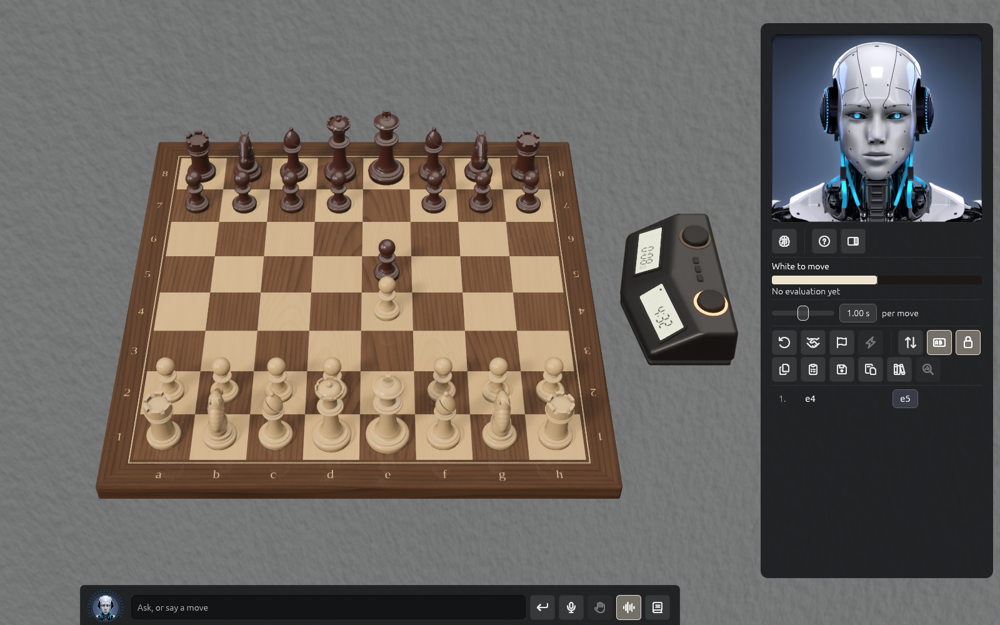

# Playing

## Moving

Click a piece, then a square, or drag it. A dragged piece lifts off the board and follows the
pointer. If you let go on a square it can't reach, it glides back. Castle by moving the king two
squares or onto its rook.

The board marks what matters. The square you picked is lit, a dot shows each quiet move the
piece can make and a ring shows each capture. The last move is lit, and so is a king in check.

When a pawn reaches the last rank, a **Promote to** window offers **Queen**, **Rook**, **Bishop**
and **Knight**. **Cancel** puts the pawn back so you can move something else.

You can't move from an earlier position. If the move list is showing an earlier move, a click on
the board brings back the game's last move and does nothing else.

When a game ends in checkmate, or a pawn promotes, the camera draws in on the move, circles the
square and pulls back. Turning the camera yourself, or **Flip**, ends it.

## Starting a game

Choose **File → New Game** (⌘N, Ctrl+N on Windows and Linux). The window asks for three things,
then **Start Game** (or press Enter) begins. **Cancel** or Esc closes it.

- **Play**: **White** or **Black** (you against Solrac), **Two players** (two people at one
  board), or **Watch** (Solrac plays both sides while you look on). The camera sits behind the
  side you play.
- **Time control**: fourteen choices in five groups, or none (see below).
- **Clock stands on**: **Left** or **Right**, as seen from White's side of the board.

Solrac remembers the kind of game you chose. A game you leave unfinished comes back as it was
the next time you start Solrac, with its clock running again after the next move. A finished game
does not come back: you start a new one of the same kind.

## Clocks

The New Game window's **Time control** lists these, fastest first:

- **Bullet**: 1+0, 2+1
- **Blitz**: 3+0, 3+2, 5+0, 5+3
- **Rapid**: 10+0, 10+5, 15+10
- **Classical**: 30+0, 30+20
- **Per move**: 5 s, 10 s, 30 s

Two numbers such as 5+3 mean five minutes each, plus three seconds after every move. 5+0 is
sudden death: no increment. A **Per move** control gives every move its own allowance, and time
you don't use is lost. A line under the buttons says what you have chosen in words, for example
"5 minutes each, plus 3 seconds after every move."

**No clock**: choose the selected side under **Clock stands on** again and the clock goes away:
both sides take as long as they like.

Your choice takes effect on the game on the board at once, and it is the clock the next new game
starts with. Each side's first move is free: no clock runs until both sides have moved once, so
you are never losing time before you have sat down, whichever colour you play.

The panel shows both clocks, White's beside Black's, with who plays each side and the time
control. The side whose time is running is lit, and a time below ten seconds turns red and shows
tenths. The 3D clock on the table shows the same times, with a lamp on the running side and a
flag that falls at 0:00. It takes no clicks. You can also move it with **Settings → Clock Position**.
On the 2D board there is no 3D clock; the panel's clocks are the clocks.

When a flag falls the player loses on time, unless the other side couldn't have mated, which is a
draw.

## Strength

Under the clock, the panel has a **Strength** row for the side Solrac plays:

- Against you, one row labelled **Solrac**.
- Watching, one row for **White** and one for **Black**.
- Between two people, none.

A slider sets the **Level** and says what it is worth, such as "≈ 1100 Lichess rapid", or "full
strength" at the top. Where Solrac allows it, switch the row to **Rating** and the slider gives a
rating from 600 to 2500 instead. Point at the slider to see more. Ratings of this kind are
engine ratings, not people's, so expect them to feel a little different.

Next to it, **per move** sets how long Solrac thinks about each move, from 0.1 to 10 seconds.
It is greyed in a game with a clock, because the clock decides: "This game's clock sets how long
Solrac thinks." The same slider is in **Preferences → Game**.

## Takebacks, Move now, pondering

- **Take back** (the first button in the panel's game row) undoes your last move. Against Solrac
  it undoes two moves, Solrac's reply and yours, so it is your turn again; between two people it
  undoes one. A clock goes back to the time it showed. It is greyed when there is no move of
  yours to take back, in a game loaded to look at, and in a Watch game. **Preferences → Game →
  Allow takebacks against Solrac** switches it off against Solrac, "like a rated game".
- **Move now** ends Solrac's search and plays its best move so far. It is lit only while Solrac is
  thinking.
- **Let Solrac ponder on your time** (**Preferences → Game**): Solrac thinks about the reply it
  expects while you think about yours, and keeps what it found if you play it. The status line
  says "Your move (Solrac is pondering)". At its lower levels, below about 1600, it doesn't ponder.
- If Solrac stops with an engine error, the status line says so and a **Restart Solrac** button
  appears under it. Press it: the game carries on.

## Draws, resigning and the end

- **Draw** between two people: either of you presses it and the game is drawn by agreement.
- **Draw** against Solrac offers it a draw. Solrac answers with its next move: it accepts unless
  it thinks it is clearly better, and playing a move declines. The status line says "You offered a
  draw." and, if it declined, "Solrac declined the draw."
- Solrac may offer you one, late in a game that is going nowhere. A **Solrac offers a draw**
  window appears with **Accept** and **Decline**. Playing a move declines it.
- **Resign** gives the game up. Use the buttons, or ask in the chat, which checks with you first.

A game ends by checkmate, stalemate, threefold repetition, the fifty-move rule, insufficient
material, time, resignation or an agreed draw. A **Game over** window then says how it ended, with:

- **Play again**: a new game of the same kind, with the clock chosen for new games.
- **Analyse** and **Review**: go through the game you just played, as [Learning from the engine](learning.md)
  describes. The same Analyse button is in the panel.
- **Close**: put the window away. It comes back if a takeback reopens the game and it ends again.

## The move list

Every move of the game is listed under the panel's buttons, with the last move lit. Click a move
to see the position after it. In a game you are playing, this is only a look: the game, the
clocks and Solrac carry on, and a click on the board brings the last move back.

Hold **Ctrl** over a move (the Control key on a Mac too) to see a small board with the position
after it, without going there. Esc puts it away. Point at a move without Ctrl to see what its
marks mean, its evaluation and the time it was played at, when the game has them.

A click on a move also gives the list the keys: ← → step through moves, Home and End go to the
first and last, and ↑ ↓ choose between a move and its variations. A click elsewhere, Esc or
typing in the chat takes the keys back. See [Keyboard shortcuts](shortcuts.md).

## Copying, saving and pasting

Four buttons in the panel's second row work with the clipboard and your documents, and the first
two are also in the **File** menu:

- **Copy FEN** copies the position on the board.
- **Copy PGN** copies the game.
- **Save PGN** saves the game as a file in the Solrac folder of your Documents folder. A line
  under the buttons says where it went.
- **Paste** loads what is on the clipboard: a game (PGN) or a position (FEN). If it holds several
  games, they go to your library instead.

You can also drop a `.pgn` file on the window. See [Your games library](games.md).

## The 2D board

Prefer a flat board, or is your computer slow? **Preferences → Chess Set → Main view → 2D board**
fills the window with a large flat board instead of the 3D one, and nothing of the 3D scene is
drawn, which is much lighter on the computer. **Automatic**, the default, chooses it for you on
a computer with a weak graphics card (see [On a slower computer](slow-computers.md)).

You move as on the 3D board: click a piece and then a square, or drag it. The squares it can go
to are marked, and the last move and a king in check are lit. Arrows and rings from the chat
are drawn on it, and a border round it carries the files and ranks (**Show board
coordinates**, or the labels button in the panel, or `L`). Choose its **Background** in
Preferences → Chess Set. The pieces are drawn again for the size of the board whenever you
resize the window. The **Flip** button, or **View → Flip Board**, turns the board over to the
other side at once. The game's clocks are in the panel, and the camera keys below don't apply.

## The camera

The camera is locked when Solrac starts, and stays locked each time: the panel's **Lock** button
unlocks it (the button is lit while locked). Unlocked, right-drag or scroll with two fingers to
orbit, and use the wheel or pinch to zoom. The arrow keys steer it, one step a press and
continuously while held. `F` flips the board, `Z` zooms to fit and `R` returns to the usual view.
All of these keys work only while the camera is unlocked.

Without unlocking, **Flip** (the panel's button, or **View → Flip Board**) always works, and so
does `L`, which shows or hides the labels round the board. **Tab** hides the whole interface:
the panel, the menu bar and the chat strip. Press it again to bring them back; what you were
typing in the chat is still there.

Next: [Learning from the engine](learning.md).
