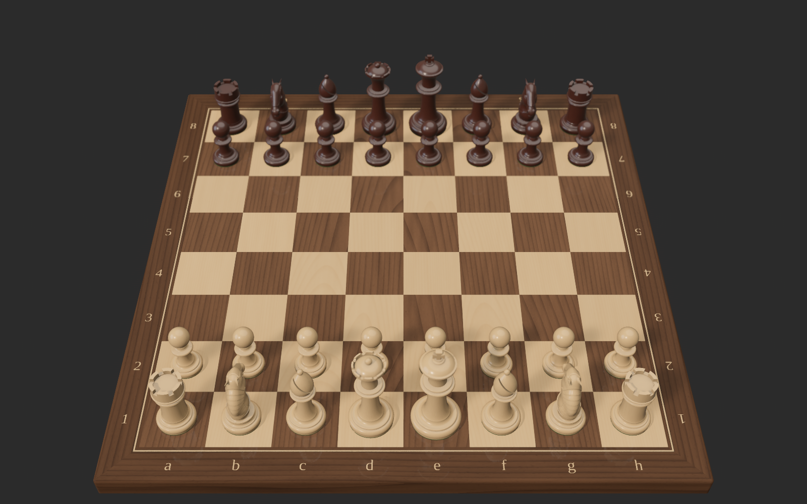
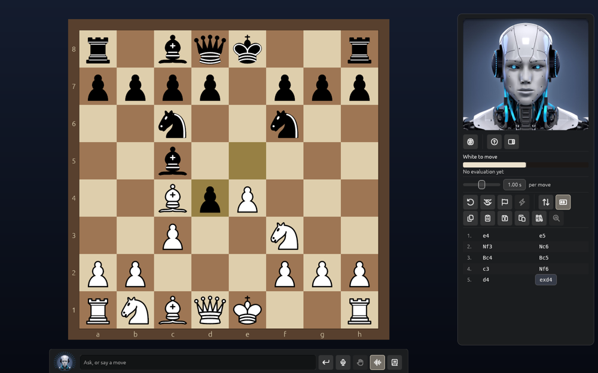

# Playing

## Moving

Click a piece, then a square, or drag it. Reachable squares light up, and a move that isn't
legal glides back. Castle by moving the king two squares or onto its rook. When a pawn
promotes, a picker offers queen, rook, bishop and knight. Right-click squares to mark them.

## Games you can play

- **You against cb2026**, as White or Black.
- **Two people at one board.**
- **cb2026 against itself**, with a strength for each side.

A game ends by checkmate, stalemate, threefold repetition, the fifty-move rule, insufficient
material, time, resignation or an agreed draw. cb2026 accepts or offers a draw by its own
judgement; between two people there is a button.

## Strength

Choose a **level from 0 to 20** (about 600 to 2500 on a human rapid scale; 20 is full
strength), or give a rating from 600 to 2500. You can also set the thinking time per move.

## Clocks

Sudden death, a Fischer increment, or a fixed time per move. A flag falls at 0:00. The 3D
clock stands on the left or right of the board.

## Takebacks, Move now, pondering

- **Takeback** is available at any point; you can switch it off against cb2026.
- **Move now** ends cb2026's search and plays its best move so far.
- **Pondering**: cb2026 thinks during your turn about the reply it expects.
- **Game → Restart cb2026** restarts the engine if it ever misbehaves.

## The 2D board

Prefer a flat board, or is your computer slow? **Preferences → Chess Set → Main view → 2D board**
fills the window with a large flat board instead of the 3D one, and nothing of the 3D scene is
drawn, which is much lighter on the computer.

You move as on the 3D board: click a piece and then a square, or drag it. The squares it can go
to are marked, and the last move and a king in check are lit. Arrows and rings from the chat
are drawn on it, and a border round it carries the files and ranks (**Show board
coordinates**, or the labels button in the panel, or `L`). Choose its **Background** in
Preferences → Chess Set. The pieces are drawn again for
the size of the board whenever you resize the window. **Flip** (the panel's button, the menu or
`F`) turns the board over to the other side at once. The game's clocks are in the panel; there
is no 3D clock on the flat board.

## The camera

Locked at the start; the **Lock** button unlocks it. Then right-drag or scroll with two
fingers to orbit, and use the wheel or pinch to zoom. `F` flips the board, `Z` zooms to fit,
`R` returns to the usual view and `L` shows or hides labels. **Tab** hides the whole interface.
