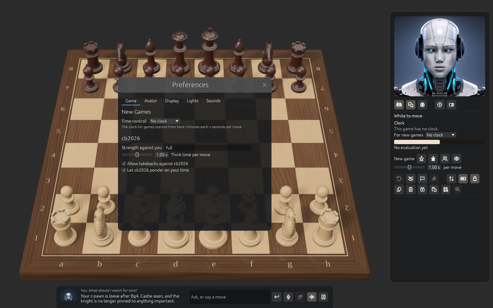
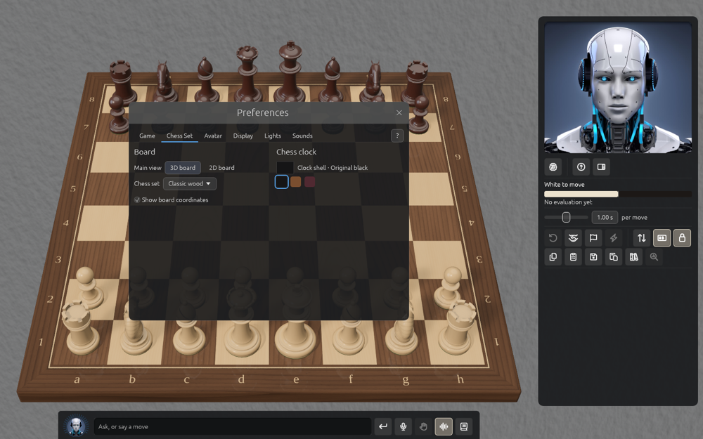
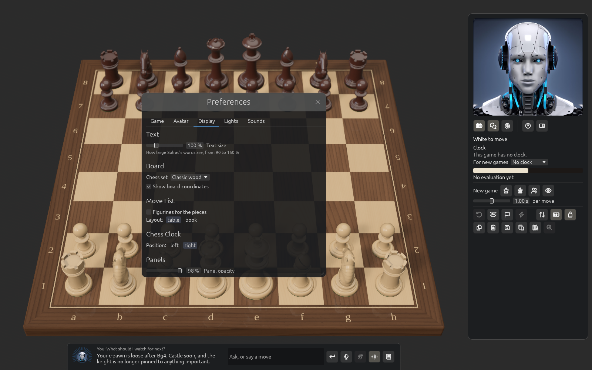
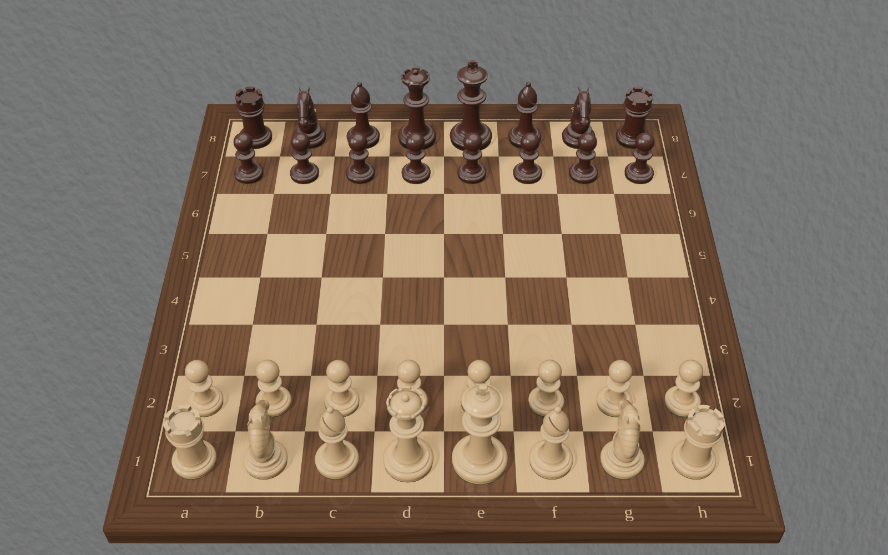
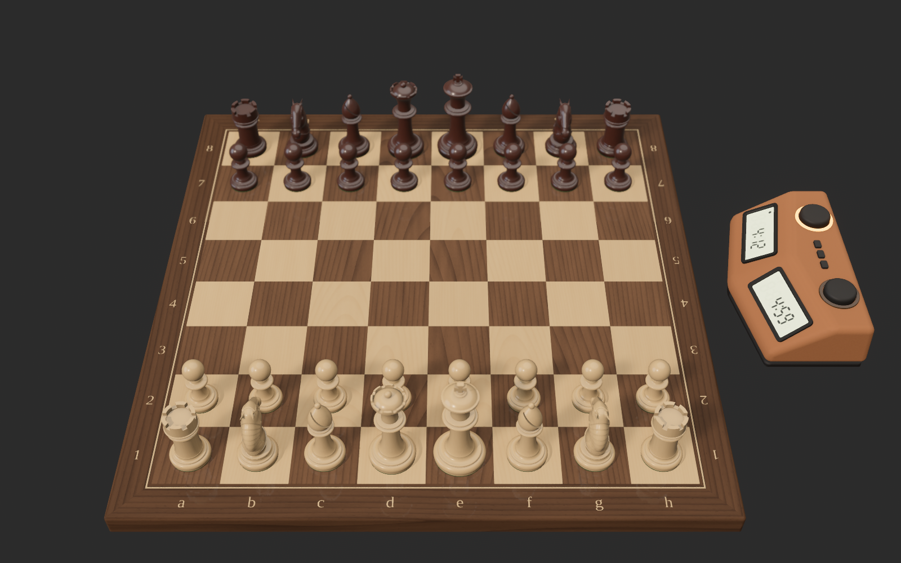

# Preferences, tab by tab

Open Preferences with ⌘, (Solrac menu). Changes take hold at once and are remembered.
The tabs, in order:

## Game

- **New Games**: the time control a new game starts with.
- **cb2026**: the strength against you (a level, or a rating), the **think time per move**
  (when a clock is running, the game's clock decides how long it thinks), **Allow takebacks
  against cb2026**, and **Let cb2026 ponder on your time** (greyed out if your cb2026 can't).

## Chess Set

- **Board**: the **Main view**, **3D board** (the photographic board and pieces) or **2D board**
  (a large flat board, see [Playing](playing.md)), the **Chess set** (Classic wood, Ebony + maple,
  Jade + Verde, Nero + Greige; the 3D board's) and **Show board coordinates** (a–h, 1–8; both
  boards).
- **Chess clock**: the colour of the clock's shell, from the picker or a swatch: Original
  black, Cognac or Burgundy. **Reset** brings the black back. It is the 3D board's clock, so it
  isn't shown while the 2D board is chosen.

## Avatar

- **Avatar**: Male, Female or Neutral Solrac, shown at the top of the panel and on the title
  screen. The picture beside the choices is the one the panel shows, moving as it does, so
  you see the Solrac you chose at once; while this tab is open, Solrac stays awake.
  **Animate Solrac** turns the animation off, leaving stills. **Show captions**
  turns off the captions above the strip. Under **Explanation**, **Detail** sets how much
  Solrac says and how many moves it shows when it explains: Short, Normal (the default) or
  Verbose. **Pace** sets how long Solrac pauses between sentences and after each move it
  shows on the board: Standard, Relaxed (the default) or Slow. The voice's own speed doesn't
  change.
- **Voice**: the voice that reads replies, a Man/Woman switch, **Play sample**, and **Read
  replies aloud**: Always, In voice mode (when Hands-free is on) or Never.

## Display

- **Text**: size from 90 to 150 % (also ⌘+ and ⌘−).
- **Move List**: **Figurines for the pieces** (♞f3 instead of Nf3) and the layout, table or
  book.
- **Chess Clock**: which side of the board it stands on, and the [colour of its shell](#clock-colour).
- **Panels**: opacity of the smoked glass (50–100 %), the colour of the panels, and the colour
  of the Engine Mind view's panels. A colour too bright for the text is dimmed to the same hue.
- **Environment**: what is behind the board: plain grey, a painted sky, or your own
  [room paint](#room-paint).

### Room paint

Choose **Room paint** in the Environment list and a plastered wall appears behind the board,
in a paint you choose, as if the board stood in a room you had painted. A **Room** section
opens under the list:

- **Wall paint**: the colour swatch opens a colour picker, and eight ready-made paints sit
  below it (plaster grey, gallery white, warm greige, sage, dusty blue, terracotta, deep
  navy and charcoal). **Reset** brings back plaster grey.
- **Finish**: **Smooth**, **Fine stucco** or **Rough**, how coarse the plaster is.
- **New texture**: plasters the wall again. The plaster is made fresh from a number (shown
  beside the button), so no two walls are quite alike, and this gives you another.
- **Colour in the light**: how much of the wall's colour reaches the board and the shine of
  the pieces. At 0 % the board is lit as it is with no environment; higher, a red wall gives
  a warm cast, as a real room would.

The wall is a backdrop, like the skies: it turns as you turn the board and stays put when you
zoom, so it never slides past the board. A very dark paint hides the plaster's grain, since
the grain is a change in brightness.

### Clock colour

The **Chess clock** section at the foot of the Display tab sets the colour of the clock's
shell, chosen the same way as the wall's paint: the colour swatch opens a colour picker, and
ready-made colours sit below it. They are the original black, cognac and burgundy. **Reset**
brings back the original black. Only the shell changes: the display, lamps and buttons keep
their own colours. Solrac remembers the colour.

## Lights

Sliders for the sun and fill light, and for the board's **Shine** and **Reflection** and the
pieces' **Clearcoat**. **Reset** puts the light back as it starts.

## Sounds

**Pieces landing** and **Clock button** can each be switched off, with one **Volume** for both.
The chat's voice has its own volume.

## Network

Pair engines on other computers and choose where games are played. See [Playing on an engine
on another computer](network-play.md).

## Licence

Shows this Mac's licence, the Macs using your key, **Deactivate this Mac**, and a note with
**Download** when a newer Solrac exists. See [Getting started](getting-started.md).

## Account

**Sign In** opens your browser; **Sign Out** and **Check again** are here too. If your account
is suspended or deleted, this tab says so.
