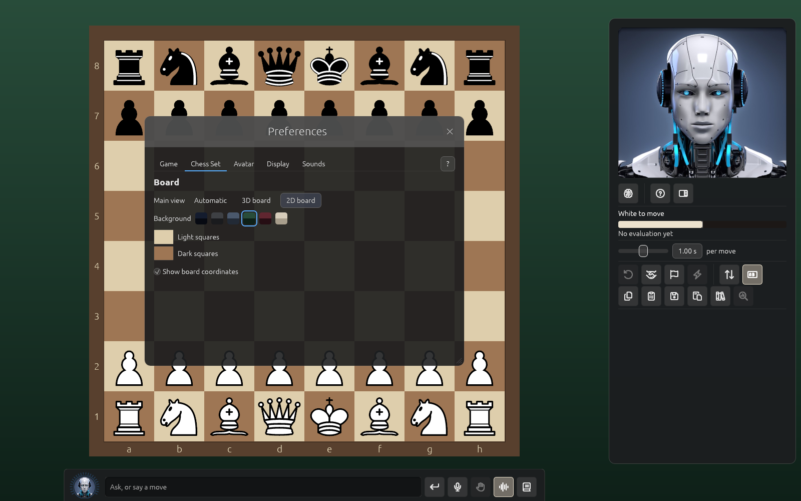

# Preferences, tab by tab

Open Preferences with ⌘, (Solrac menu), or with **Settings → All Settings...**. Changes take
hold at once and are remembered. A **?** beside the tabs opens the part of this page for the tab
you are on. The tabs, in the order you see them: Game, Chess Set, Avatar, Display, Lights,
Sounds, Licence, Network and Account.

Preferences shows only what applies to the board you are using. With the 2D board there is no
Lights tab, no chess set or chess clock, and no Environment under Display, and the View and
Settings menus leave out the camera, Environment and Clock Position. If you are on the Lights
tab when you switch to the 2D board, Preferences moves you to Chess Set.

Solrac also remembers the size of its window. If the screen is too small for it, Solrac
shrinks the window to fit, keeping its shape, and remembers that size instead.

## Game

The heading is **Solrac**. You choose a game's time control in the New Game window, and Solrac's
strength for the game in the panel (see [Playing a game](playing.md)). Here are the settings
that stay the same from game to game:

- **Think time per move**: from 0.1 to 10 seconds, 1 second to start. It is for games without a
  clock; when a clock is running, the clock decides how long Solrac thinks, and the slider is
  greyed out with a note that says so.
- **Allow takebacks against Solrac**: on to start. Turn it off and moves against Solrac can't be
  taken back, as in a rated game.
- **Let Solrac ponder on your time**: on to start. Solrac thinks about the reply it expects
  while you think, and keeps what it found if you play that reply. At its lower levels, below
  about 1600, it doesn't expect a reply, so it doesn't ponder. The box is greyed out if your
  Solrac can't ponder.
- **Cores for Solrac**: how many of your computer's processor cores Solrac thinks with, from 1
  to all of them. It starts at 1. More cores search deeper in the same time but leave less for
  everything else. Changing it restarts Solrac's engine, and the game carries on. On a computer
  with one core the slider is greyed out.

## Chess Set

Two columns: **Board**, and **Chess clock** (3D board only).

- **Main view**: **Automatic**, **3D board** (the photographic board and pieces) or **2D board**
  (a large flat board, see [Playing a game](playing.md)). A line under it says what Automatic
  chose. Automatic picks the 2D board on a computer with a weak graphics card; see
  [On a slower computer](slow-computers.md).
- **Chess set** (3D board): **Classic wood**, **Ebony + maple**, **Jade + Verde** or **Nero +
  Greige**. Hover a set to read what it is made of.
- **Background** (2D board): **Midnight**, **Graphite**, **Slate**, **Forest**, **Wine** or
  **Sand**, each a swatch.
- **Light squares** and **Dark squares** (2D board): each from a colour picker with its own
  **Reset**. **Reset board colours** appears once you change either, and puts both back. The
  dark squares' colour is also the colour of the border round the board.
- **Show board coordinates**: the letters a–h and figures 1–8 round the board, on both boards,
  on to start. The **L** key and the panel's labels button switch them too.
- **Chess clock** (3D board): the colour of the clock's shell. Pick it from the colour picker,
  or click a swatch: **Original black** (the usual one), **Cognac** or **Burgundy**. **Reset**
  appears once you change it.

Which side of the board the clock stands on, as you see the board from White's seat, is under
**Settings → Clock Position** in the menu bar: **left** or **right**, right to start.

## Avatar

Three sections: Appearance, Voice and Explanation.

**Appearance**

- **Avatar**: **Male**, **Female** or **Neutral** Solrac, shown at the top of the panel and on
  the title screen. The picture beside the choices is the one the panel shows, moving as it does; while this tab is open, Solrac stays awake.
- **Animate Solrac**: on to start. Turn it off and the avatar shows only stills, awake or asleep.
- **Show captions**: on to start. What Solrac says appears as closed captions above the Rail, a
  sentence at a time, whether or not it is read aloud.

**Voice**

- **Man**, **Woman** or **Neutral**: the kind of voice. The list beside them holds the voices
  of that kind. Neutral lists Alloy (en-US), Dora (es), Dora (pt-BR), Nezumi and Alpha (ja).
  Until Solrac's voice has loaded, the tab says so and there is nothing to choose.
- **Play**: Solrac reads a sample in the voice you chose, and the button becomes **Stop**.
  It sends no message.
- **Read replies aloud**: **Automatic** (the choice to start: everything is read aloud on most
  computers, but only in voice mode on a weak one, see
  [On a slower computer](slow-computers.md)), **Always**, **In voice mode** (when Hands-free is
  on) or **Never**. See [The chat and voice](chat-and-voice.md).

If the voice you saved is no longer there, an orange note says Solrac reads in another one and
asks you to choose again.

**Explanation**

How Solrac explains things in the chat and on the board.

- **Detail**: **Short** (the point in a sentence, with one short line shown on the board),
  **Normal** (a few sentences and a line or two, the choice to start) or **Verbose**
  (everything).
- **Pace**: **Standard**, **Relaxed** or **Slow**: how long Solrac pauses between sentences and
  after each move it shows on the board. The voice itself doesn't speak any slower.

## Display

- **Text**: **Text size** has five steps: 90, 100 (the usual), 115, 130 and 150 %. Drag the
  slider, or type a percentage and it moves to the nearest step. ⌘+ and ⌘− (the View menu's
  Larger Text and Smaller Text) change it too.
- **Graphics**: **Quality**, **Automatic**, **High** or **Low**. A line under it says what
  Automatic is drawing. See [On a slower computer](slow-computers.md).
- **Move List**: **Figurines for the pieces** (♞f3 instead of Nf3), and **Layout**, **table**
  (a row a move) or **book** (the moves in flowing text, as a book prints them).
- **Panels**: **Panel opacity** of the smoked glass, 50 to 100 % (98 % to start), **Panel
  colour**, and **Engine Mind colour** for the Engine Mind view's panels. Each colour has a
  **Reset**. A colour too bright for the text is dimmed to the same hue.
- **Environment** (3D board): what surrounds the board. The list holds **None**, **Room paint**
  (the choice to start), **Slate**, **Gray slate**, **Violet nebula**, **Blue nebula**,
  **Clouds at sunset** and **Clouds at night**. A spinner shows while a sky is being painted.
  The View menu has the same list under **Environment**.

With **Room paint**, the room is a plastered wall of your own colour, and a **Room** section opens under the list:

- **Wall paint**: a colour picker, and swatches for **Plaster grey** (the usual), **Gallery
  white**, **Warm greige**, **Sage**, **Dusty blue**, **Terracotta**, **Deep navy** and
  **Charcoal**. The name of the paint shows beside the picker, or **Custom colour**. **Reset**
  goes back to Plaster grey.
- **Finish**: **Smooth**, **Fine stucco** or **Rough**, how rough the plaster is.
- **New texture**: plasters the wall again, the same paint on a different wall. The plaster is made fresh from a number (shown beside the button), so no two walls are quite alike.
- **Colour in the light**: from 0 to 100 % (25 % to start), how much of the wall's colour
  reaches the board and the pieces' lacquer. At 0 % the board is lit as it is with no environment; higher, a red wall gives a warm cast, as a real room would.

The wall is a backdrop, like the skies: it turns as you turn the board and stays put when you zoom, so it never slides past the board. A very dark paint hides the plaster's grain, since the grain is a change in brightness.

## Lights

The 3D board only. **Lighting** has **Sun** (about 81 to 5200 lux, 650 to start) and **Fill**
(12.5 to 800 %, 100 % to start). Both reach three stops (a doubling each) either side of where they start. Under **Board**, **Shine** (0 to 100 %, 10 % to start) is the sun's
and the room's highlights in the board's lacquer, and **Reflection** (0 to 200 %, 50 % to start)
is how much the board mirrors the pieces, where 100 % is what real lacquer reflects. Under
**Pieces**, **Clearcoat** (0 to 100 %, 100 % to start) is the glossy shine on the pieces.
**Reset** puts the light back as it starts. You can also ask Solrac in the chat to change the
lights.

## Sounds

Under **Sound Effects**, **Pieces landing** (wood on wood as each piece reaches its square) and
**Clock button** (a press of the chess clock after each move, in a game with a clock) can each
be switched off, and both are on to start. **Volume** is one for both, 0 to 100 % (70 % to
start); it is greyed out when both are off. The chat's voice has its own volume.

The same two switches are in the menu bar, under **Settings → Sound**.

## Licence

Shows this machine's licence, the machines using your key, **Deactivate this machine**, and a note with
**Download** when a newer Solrac exists. In the Mac App Store version this tab has **Buy tokens**
and **Restore Purchases** instead, and no Download. See [Getting started](getting-started.md).

## Network

Pair engines on other computers and choose where games are played. See
[Playing on another computer](network-play.md).

## Account

**Sign In** opens your browser; **Sign Out** and **Check again** are here too. If your account
is suspended or deleted, this tab says so. See [Getting started](getting-started.md).
