# Settings, page by page

Open Settings with ⌘, (**Solrac → Settings...**), or with **Settings → All Settings...**. On an
iPad, choose **Settings…** in the menus on the left. Changes take hold at once and are
remembered.

Settings has a list of pages down its left side: Game, Chess Set, Display, Avatar, Sounds, Voice
and Chat, Lights, Account, Licence (Purchases in the App Store versions), Network and Help.
Click or tap one to show it. A **?** at the top of each page opens the part of this page about
it.

On a Mac, Windows or Linux, Settings is a window you can move and leave open while you play. On
an iPad it is a small sheet, half the window's height, that opens in the middle of the window's
height just right of the menus' words (at the left side when they are hidden), so most of the
board stays in view; its page scrolls, and dragging the bar along its top moves it anywhere. It
shows the list of pages first: tap one to open it, and **‹ Settings** to go back to the list.
**Done** (or Esc on a keyboard) puts it away. The sheet dims the board, but not on Chess Set,
Display or Lights, so you can see your changes as you make them.

Settings shows only what applies to the board you are using. With the 2D board there is no
Lights page, no chess set or chess clock, and no Environment under Display, and the View and
Settings menus leave out the camera, Environment and Clock Position. If you are on the Lights
page when you switch to the 2D board, Settings moves you to Chess Set.

Solrac also remembers the size of its window. If the screen is too small for it, Solrac
shrinks the window to fit, keeping its shape, and remembers that size instead.

## Game

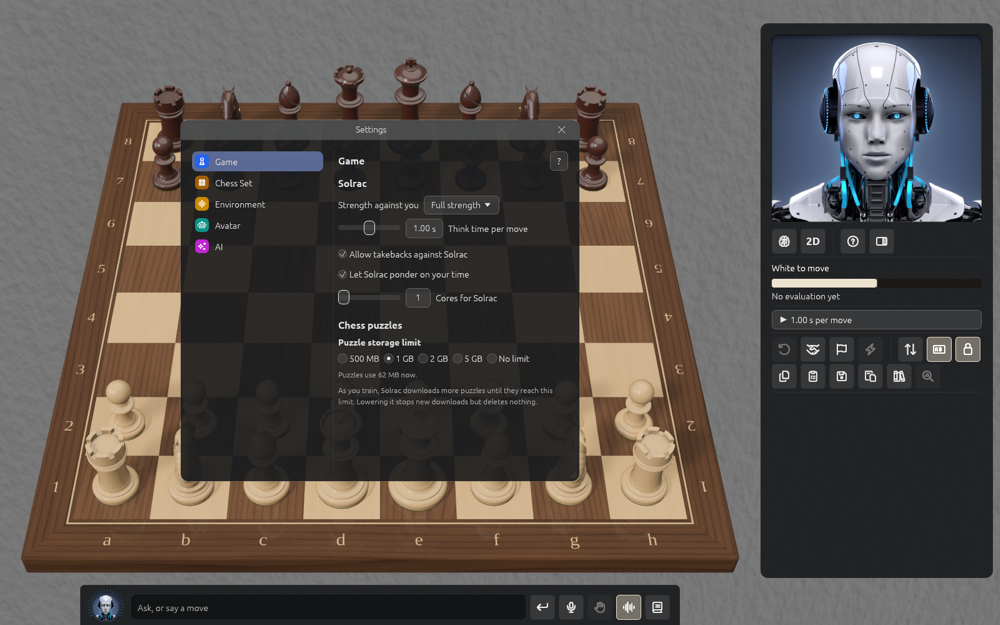

The heading is **Solrac**. You choose a game's time control in the New Game sheet (see
[Playing a game](playing.md)). Here are the settings that stay the same from game to game:

- **Strength against you**: a list of Solrac's levels, each with the rating it plays at, then
  full strength. It is the same setting as the New Game sheet's strength and the panel's
  strength row, so a change in any one of them shows in the others. A rating chosen in the
  panel shows here as that rating until you pick a level.
- **Think time per move**: from 0.1 to 10 seconds, 1 second to start. It is for games without a
  clock; when a clock is running, the clock decides how long Solrac thinks, and the slider is
  greyed out with a note that says so.
- **Allow takebacks against Solrac**: on to start. Turn it off and moves against Solrac can't be
  taken back, as in a rated game.
- **Let Solrac ponder on your time**: on to start. Solrac thinks about the reply it expects
  while you think, and keeps what it found if you play that reply. At its lower levels, below
  about 1600, it doesn't expect a reply, so it doesn't ponder. The box is greyed out if your
  Solrac can't ponder.
- **Cores for Solrac**: how many of your computer's processor cores Solrac thinks with, from 1
  to all of them. It starts at 1. More cores search deeper in the same time but leave less for
  everything else. Changing it restarts Solrac's engine, and the game carries on. On a computer
  with one core the slider is greyed out.

Under **Chess puzzles**:

- **Puzzle storage limit**: 500 MB, 1 GB (to start), 2 GB, 5 GB or No limit. As you train, Solrac
  downloads more puzzles until they take this much disk (see
  [Chess puzzles](puzzles.md)). The line under it says how much they use now. Lowering the
  limit stops new downloads but deletes nothing, even when the puzzles already use more than
  the new limit.

## Chess Set

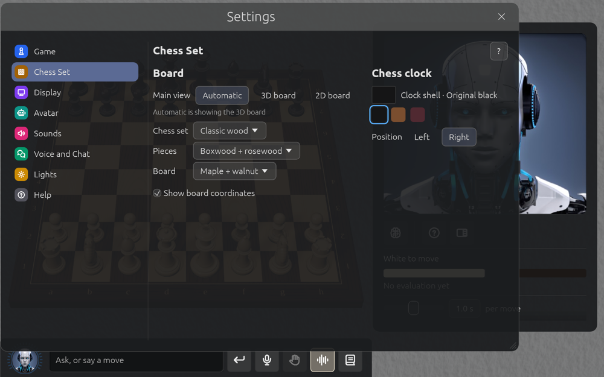

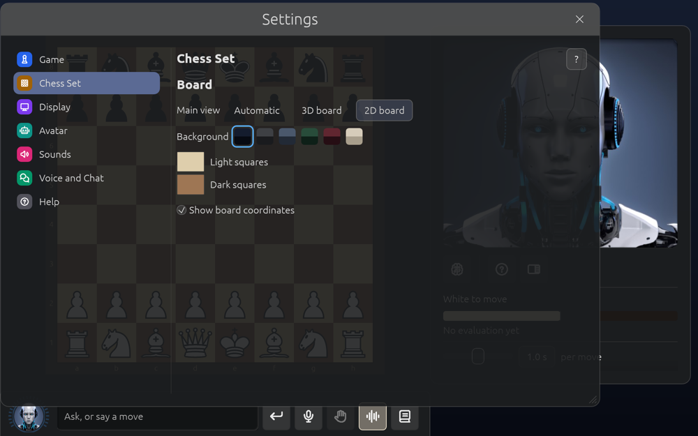

Two columns: **Board**, and **Chess clock** (3D board only).

- **Main view**: **Automatic**, **3D board** (the photographic board and pieces) or **2D board**
  (a large flat board, see [Playing a game](playing.md)). A line under it says what Automatic
  chose. Automatic picks the 2D board on a computer with a weak graphics card; see
  [On a slower computer](slow-computers.md).
- **Chess set** (3D board): **Classic wood**, **Ebony + maple** or **Medieval pewter**, each
  its pieces on its own board. **Medieval pewter** is a set of cast figures (a king with his
  sword, a queen, a bishop with his crozier, an armoured warhorse and a brick tower) in
  polished and blackened pewter on oak. Hover a set to read what it is made of.
- **Pieces** and **Board** (3D board): any pieces on any board, say the Medieval pewter
  figures on the maple and ebony board. **Pieces** has three more sets of pieces besides the
  three sets': **Jade + black** and **Carrara + Nero**, the Classic pieces' shapes in stone,
  and **1852 Staunton**, the heavier Staunton of the first sets, with its carved knight, in
  boxwood and ebony. Choosing a **Chess set** sets both; when they come from different sets,
  **Chess set** says **Custom**. Some pieces are hard to tell
  from some squares (the pewter figures on maple, say), and then an orange line under the menus says
  so: "These pieces are hard to see on these squares." You can still play with them.
  Below the sets' boards, under a line, **Board** lists five boards with edges of their own,
  each in its own woods: **Regency** (a carved, stepped border under a raised field, in bud
  rosewood), **Rounded** (large rounded corners, in golden rosewood), **Bevel** (a wide
  bevel on an ebony frame banded in golden rosewood), **Raised field** (the squares standing
  above a matt walnut frame) and **End grain** (a thick block with no frame, so it has no
  coordinates). The chess clock and the captured pieces move to suit each board's size.
- **Background** (2D board): **Midnight**, **Graphite**, **Slate**, **Forest**, **Wine** or
  **Sand**, each a swatch.
- **Light squares** and **Dark squares** (2D board): each from a colour picker with its own
  **Reset**. **Reset board colours** appears once you change either, and puts both back. The
  dark squares' colour is also the colour of the border round the board.
- **Show board coordinates**: the letters a–h and figures 1–8 round the board, on both boards,
  on to start. The **L** key and the panel's labels button switch them too.
- **Chess clock** (3D board): the colour of the clock's shell. Pick it from the colour picker,
  or click a swatch: **Original black** (the usual one), **Cognac** or **Burgundy**. **Reset**
  appears once you change it.

- **Position** (3D board): which side of the board the clock stands on, as you see the board
  from White's seat, **Left** or **Right**, Right to start. The menu bar has the same choice
  under **Settings → Clock Position**.

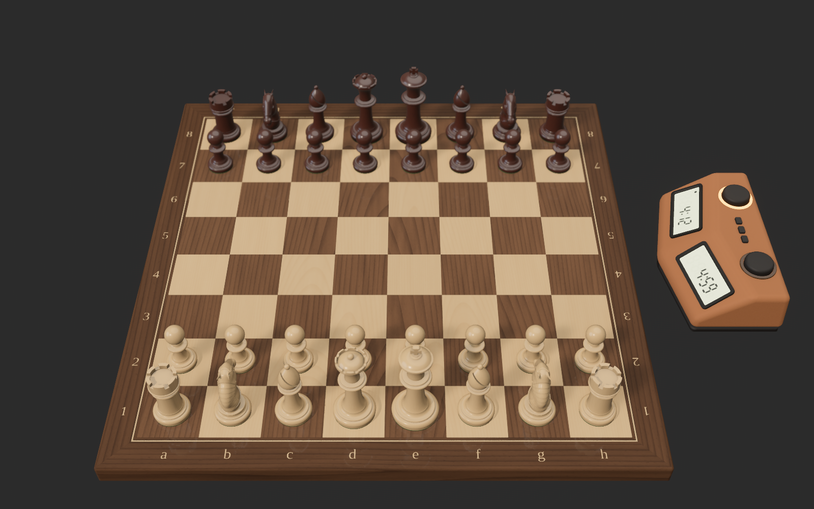

## Avatar

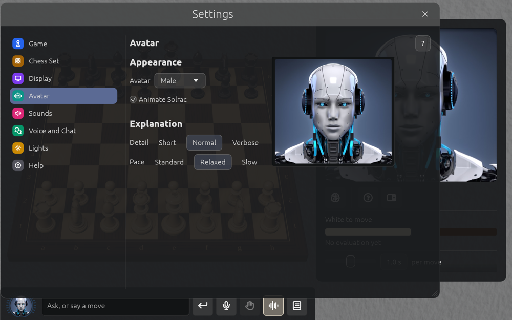

Two sections: Appearance and Explanation. The voice Solrac reads in is on the
[Voice and Chat](#voice-and-chat) page.

**Appearance**

- **Avatar**: **Male**, **Female** or **Neutral** Solrac, shown at the top of the panel and on
  the title screen. The picture beside the choices is the one the panel shows, moving as it does; while this page is open, Solrac stays awake.
- **Animate Solrac**: on to start. Turn it off and the avatar shows only stills, awake or asleep.
**Explanation**

How Solrac explains things in the chat and on the board.

- **Detail**: **Short** (the point in a sentence, with one short line shown on the board),
  **Normal** (a few sentences and a line or two, the choice to start) or **Verbose**
  (everything).
- **Pace**: **Standard**, **Relaxed** or **Slow**: how long Solrac pauses between sentences and
  after each move it shows on the board. The voice itself doesn't speak any slower.

## Display

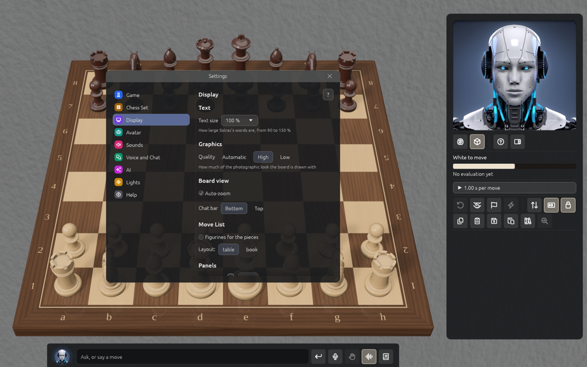

- **Text**: **Text size** has five steps: 90, 100 (the usual), 115, 130 and 150 %. Drag the
  slider, or type a percentage and it moves to the nearest step. ⌘+ and ⌘− (the View menu's
  Larger Text and Smaller Text) change it too.
- **Graphics**: **Quality**, **Automatic**, **High** or **Low**. A line under it says what
  Automatic is drawing. See [On a slower computer](slow-computers.md).
- **Move List**: **Figurines for the pieces** (♞f3 instead of Nf3), and **Layout**, **table**
  (a row a move) or **book** (the moves in flowing text, as a book prints them).
- **Panels**: **Panel opacity** of the smoked glass, 50 to 100 % (98 % to start), **Panel
  colour**, and **Engine Mind colour** for the Engine Mind view's panels. Each colour has a
  **Reset**. A colour too bright for the text is dimmed to the same hue.
- **Environment** (3D board): what surrounds the board. The list holds **None**, **Room paint**
  (the choice to start), **Slate**, **Gray slate**, **Violet nebula**, **Blue nebula**,
  **Clouds at sunset** and **Clouds at night**. A spinner shows while a sky is being painted.
  The View menu has the same list under **Environment**.

With **Room paint**, the room is a plastered wall of your own colour, and a **Room** section opens under the list:

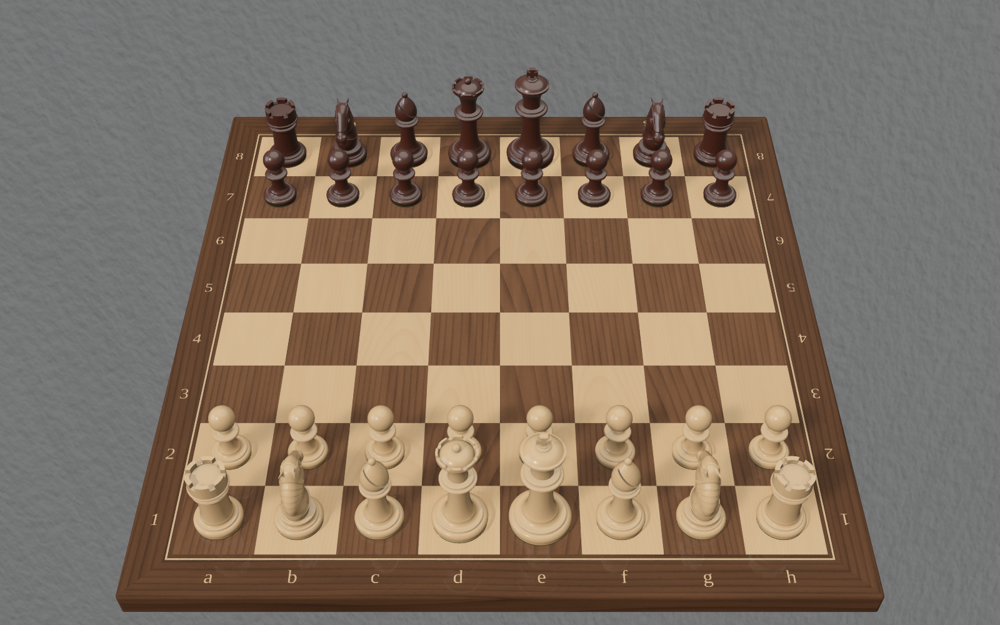

- **Wall paint**: a colour picker, and swatches for **Plaster grey** (the usual), **Gallery
  white**, **Warm greige**, **Sage**, **Dusty blue**, **Terracotta**, **Deep navy** and
  **Charcoal**. The name of the paint shows beside the picker, or **Custom colour**. **Reset**
  goes back to Plaster grey.
- **Finish**: **Smooth**, **Fine stucco** or **Rough**, how rough the plaster is.
- **New texture**: plasters the wall again, the same paint on a different wall. The plaster is made fresh from a number (shown beside the button), so no two walls are quite alike.
- **Colour in the light**: from 0 to 100 % (25 % to start), how much of the wall's colour
  reaches the board and the pieces' lacquer. At 0 % the board is lit as it is with no environment; higher, a red wall gives a warm cast, as a real room would.

The wall is a backdrop, like the skies: it turns as you turn the board and stays put when you zoom, so it never slides past the board. A very dark paint hides the plaster's grain, since the grain is a change in brightness.

## Lights

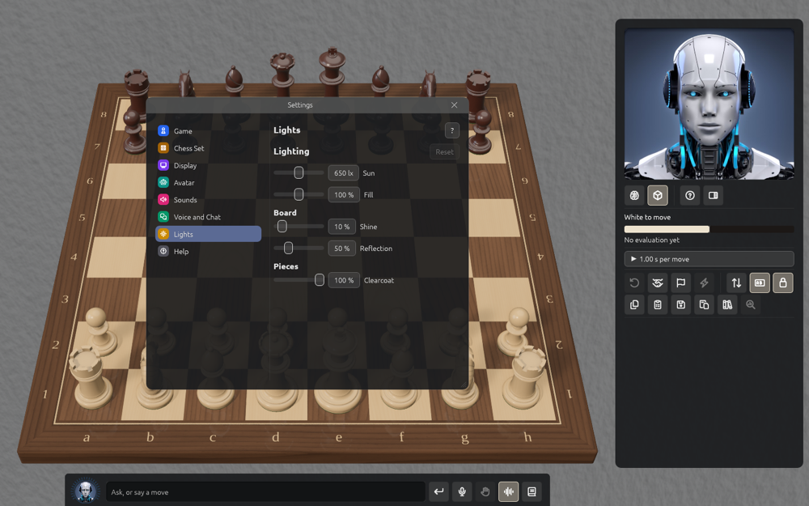

The 3D board only. **Lighting** has **Sun** (about 81 to 5200 lux, 650 to start) and **Fill**
(12.5 to 800 %, 100 % to start). Both reach three stops (a doubling each) either side of where they start. Under **Board**, **Shine** (0 to 100 %, 10 % to start) is the sun's
and the room's highlights in the board's lacquer, and **Reflection** (0 to 200 %, 50 % to start)
is how much the board mirrors the pieces, where 100 % is what real lacquer reflects. Under
**Pieces**, **Clearcoat** (0 to 100 %, 100 % to start) is the glossy shine on the pieces.
**Reset** puts the light back as it starts. You can also ask Solrac in the chat to change the
lights.

## Sounds

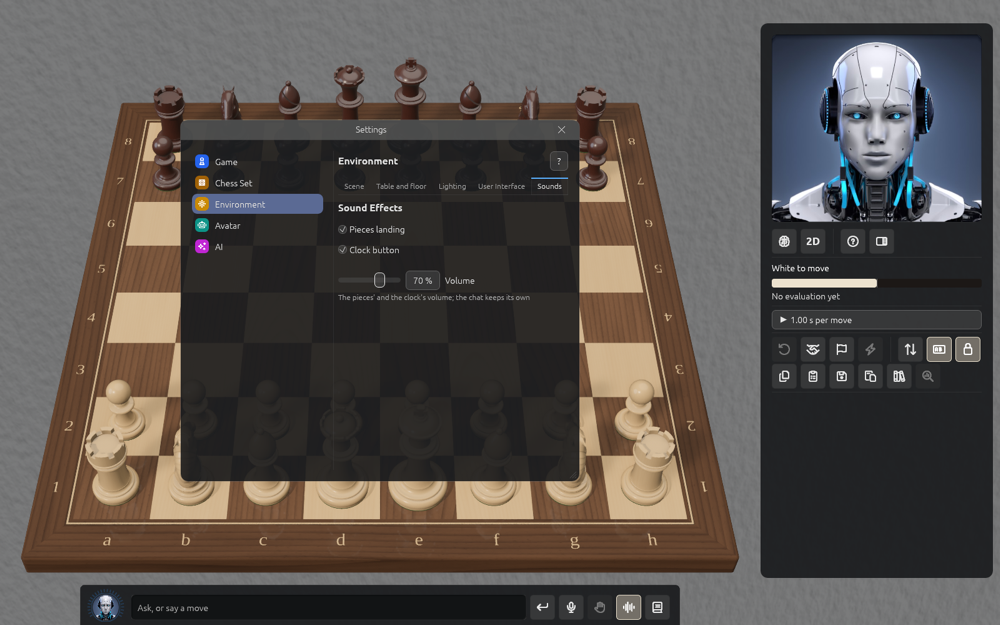

Under **Sound Effects**, **Pieces landing** (wood on wood as each piece reaches its square) and
**Clock button** (a press of the chess clock after each move, in a game with a clock) can each
be switched off, and both are on to start. **Volume** is one for both, 0 to 100 % (70 % to
start); it is greyed out when both are off. The chat's voice has its own volume.

The same two switches are in the menu bar, under **Settings → Sound**.

## Voice and Chat

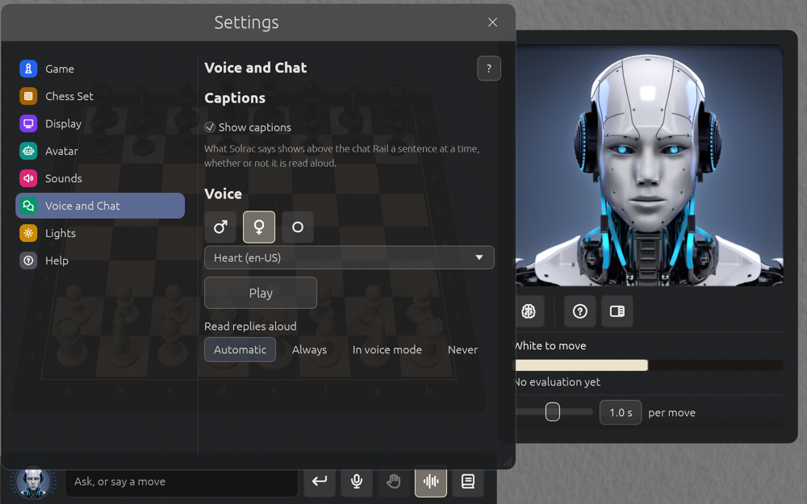

**Online coach**

- **Let the chat use the online coach**: what Solrac asked before your first chat message. What
  you type or say to the chat (as text) goes, with the game, to the Solrac Chess AI Coach: through
  PNX Studios' server to OpenRouter and the company whose language model answers. Your voice
  itself is heard here and never sent.
  Off, the chat asks again before your next message is sent. See
  [The chat and voice](chat-and-voice.md).

**Captions**

- **Show captions**: on to start. What Solrac says appears as closed captions above the Rail, a
  sentence at a time, whether or not it is read aloud.

**Voice**

- **Man**, **Woman** or **Neutral**: the kind of voice. The list beside them holds the voices
  of that kind. Neutral lists Alloy (en-US), Dora (es), Dora (pt-BR), Nezumi and Alpha (ja).
  Until Solrac's voice has loaded, the page says so and there is nothing to choose. On an iPad
  where you chose **Not now** to the voice's download, the page says so instead, with
  **Download**.
- **Play**: Solrac reads a sample in the voice you chose, and the button becomes **Stop**.
  It sends no message.
- **Read replies aloud**: **Automatic** (the choice to start: everything is read aloud on most
  computers, but only in voice mode on a weak one, see
  [On a slower computer](slow-computers.md)), **Always**, **In voice mode** (when Hands-free is
  on) or **Never**. See [The chat and voice](chat-and-voice.md).

If the voice you saved is no longer there, an orange note says Solrac reads in another one and
asks you to choose again.

## Licence and Purchases

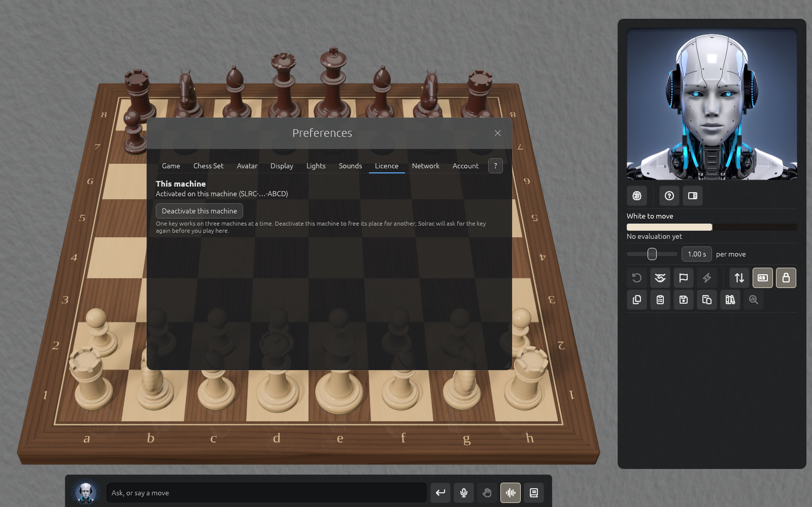

Shows that this machine is activated, with the end of the key, a note with **Download** when a
newer Solrac exists, and **Deactivate this machine**. The list of machines that use your key shows
only when you try a fourth one. In the Mac App Store version this page is called **Purchases**,
and has **Buy tokens** and **Restore Purchases** instead, and no Download. On an iPad it is
**Purchases** too, and will show your App Store purchase and your chat tokens. See
[Getting started](getting-started.md).

## Network

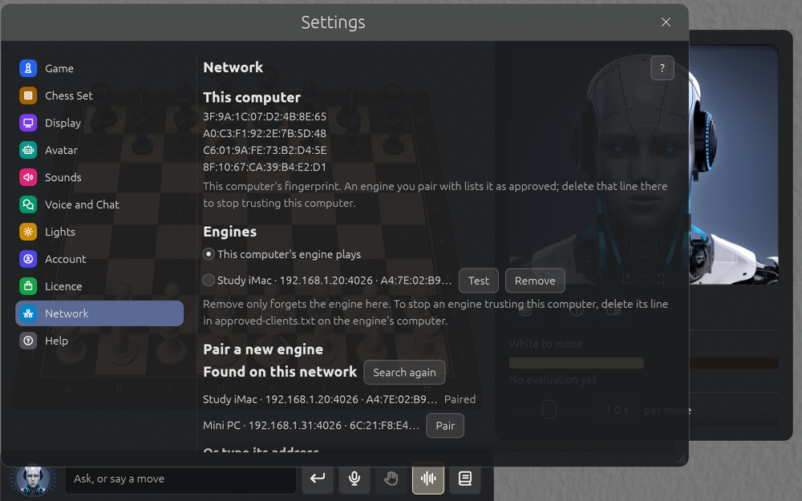

Pair engines on other computers and choose where games are played. See
[Playing on another computer](network-play.md).

## Account

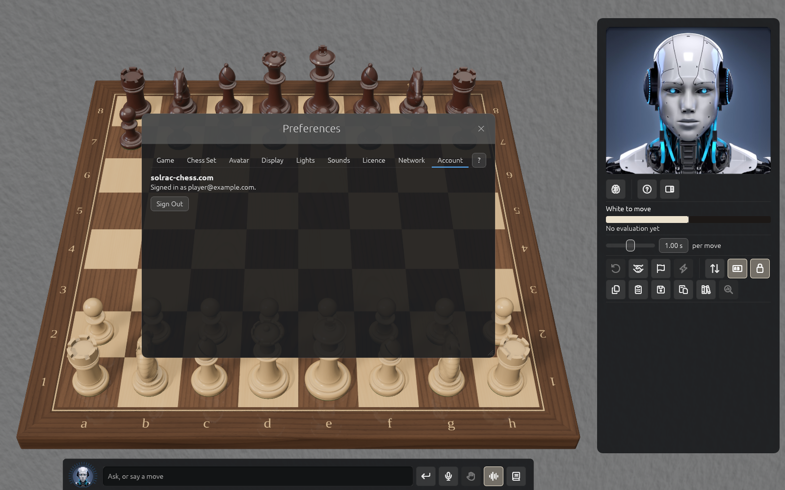

**Sign In** opens your browser; **Sign Out** and **Check again** are here too. If your account
is suspended or deleted, this page says so. See [Getting started](getting-started.md).

**Delete Account…** deletes your solrac-chess.com account. Solrac first says what that does and
asks again: choose **Delete Account** to go ahead, or **Cancel**. Your account is signed out
everywhere at once and deleted 14 days later, with its tokens and their history. Signing in on
solrac-chess.com before then cancels the deletion. Your games and settings in Solrac stay. For
your security, deleting needs a sign-in in the last 15 minutes: if yours is older, Solrac asks
you to choose **Sign In Again**, then **Delete Account…** once more.

## Help

Buttons for **Solrac Help** (these pages), **Keyboard Shortcuts**, **Solrac Documentation**
(cb2026's book, in your browser; not on an iPad), **Send Feedback…** and **About Solrac**. On an
iPad, Settings closes as the one you choose opens.

