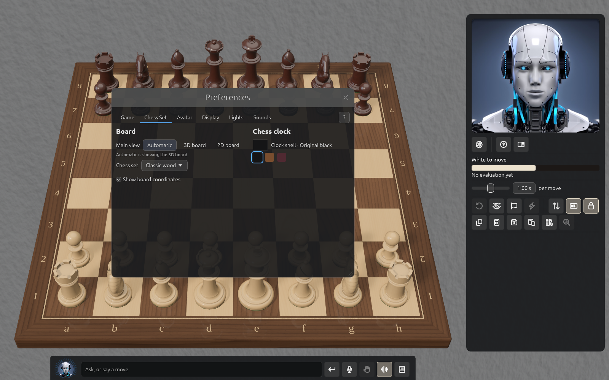

# On a slower computer

Solrac's 3D board is a photograph drawn many times a second, and its voice is a speech model
running on your own computer. A computer with a small graphics chip, an older processor or
little memory may find that too much. Solrac notices some of it for you, and the rest you can
choose.

## What Solrac does by itself

When it starts, Solrac asks the graphics card what it is. A **software renderer** (what a
remote desktop session gives you) or an Intel **HD** or **UHD Graphics** chip counts as a weak
one. Then, unless you have chosen otherwise:

- **The main view is the 2D board.** It is drawn by the panel's own code, with no 3D scene, and
  is the biggest saving: on a small Intel chip it drew about 60 frames a second where the 3D
  board managed about 12.
- **If you choose the 3D board, Quality is Low.** Low leaves out shadows, the pieces'
  reflection in the board, ambient occlusion, depth of field and glow, and draws the board at
  two thirds of the window's size. Pieces still shine and the room still lights them.
- **Replies and moves are read aloud only in the Rail's Voice mode.** Making speech takes
  several of the processor's cores for ten seconds or more, which also slows the board.

Every other computer gets the 3D board, High quality and everything read aloud, as before.
Preferences says when Automatic has chosen for you: *Automatic is showing the 2D board: this
graphics card is a weak one.*

## Choosing for yourself

- **Main view** (Preferences → Chess Set): **Automatic**, **3D board** or **2D board**. See
  [the 2D board](playing.md#the-2d-board).
- **Quality** (Preferences → Display → Graphics): **Automatic**, **High** or **Low**.
- **Read replies aloud** (Preferences → Avatar → Voice, and the speaker button in the
  Rail): **Automatic**, **Always**, **In voice mode** or **Never**. Choosing **Always** reads
  everything, as on a stronger computer; the speaker button turns reading on or off for now.

Your choice is kept, and beats Automatic from then on, even if you later change computers.
Choosing **Automatic** again hands the decision back.

## If it is still slow

- Close other programs, especially browsers: Solrac shares the processor with them.
- Use a smaller window: the board is drawn at the window's size.
- Turn **Show captions** off (Preferences → Avatar) if you don't read them.
- Set **Cores for Solrac** (Preferences → Game) to 1, so the engine leaves room for the board.
- A remote desktop is much slower than the computer's own screen, because it has no graphics
  chip. Run Solrac from the computer's own display.
